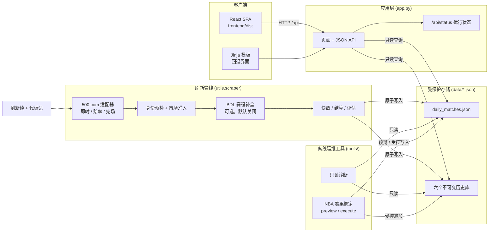
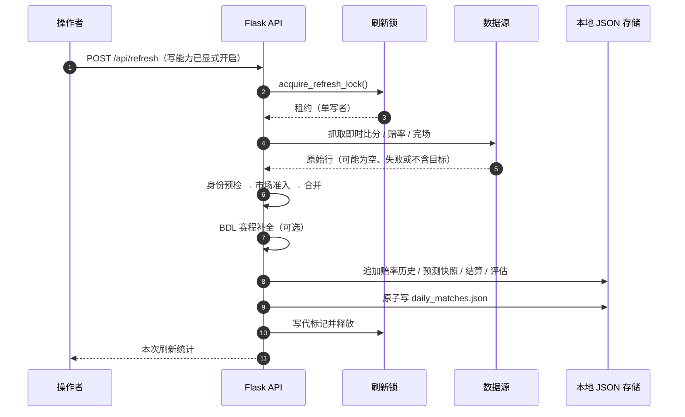

# 每日实时体彩预测终端 (Daily Sports-Lottery Terminal)

> 面向竞彩足球与竞彩篮球的本地预测、历史留存与模型评估终端。

[](https://github.com/YGone-001/Daily-Sports-Lottery/actions/workflows/ci.yml)


项目从公开赛程源抓取**有真实盘口覆盖**的竞彩赛事，用 Elo 实力先验与统计学比分模型输出
胜平负概率、比分分布、大小球倾向与价值盘口；同时把「赛前预测」固化为不可变历史记录，
并在赛后用真实终场比分完成结算与可复现的模型评估。

技术上是一个 **Flask + 本地 JSON 存储** 的单机应用，前端为 **React 18 + TypeScript + Vite**：
启动脚本构建前端后设置 `SERVE_FRONTEND=1`，由 Flask 托管 `frontend/dist`；未构建或未设置时
回退 Jinja 模板界面。应用**默认只读**：启动本身不会抓取、不会写入任何生产存储，
真实刷新必须由操作者显式开启并触发。

> 本项目输出的是模型视角下的概率估计，不构成投注建议。

## ✨ 核心特性

- **有盘口才跟踪**：市场准入以「完整可用盘口」为唯一判据，不设联赛白名单；被准入后保持生命周期连续。
- **足篮双模型**：足球为 Elo → 期望进球 → 泊松 + Dixon-Coles；篮球为 Elo → 预期得分 → 正态分差与总分。
- **市场对撞与价值扫描**：模型概率与去水后的市场隐含概率按权重融合，并输出 EV / Fractional Kelly。
- **不可变预测历史**：每场比赛 × 每个模型版本仅一条赛前快照，`snapshot_id` 确定性可复现。
- **赛后闭环**：赔率历史 → 预测快照 → 结算（快照 × 终场比分）→ 评估样本，四层数据只追加、不改写。
- **可复现评估**：Accuracy / Brier / LogLoss、10 分箱校准与 ECE、按时间窗的 Temporal Evaluation。
- **NBA 专用链路**：BALLDONTLIE 赛程时间补全、受控赛果绑定预览/执行、只读赛果投递诊断。
- **可复用赛果工作流**：目标选择 → 有界请求计划 → 官方/BDL 证据采集 → 离线校验 → 严格批量预览，默认离线。
- **安全默认值**：默认只读、跨进程刷新锁、代标记、七库摘要比对；生产修复需要 Ed25519 授权。

## 🏗️ 架构总览



| 边界 | 关键实现 | 职责 |
| --- | --- | --- |
| Web 应用 | [app.py](app.py) | 页面路由、JSON API、运行能力状态；不触发抓取 |
| 抓取与合并 | [utils/scraper.py](utils/scraper.py) | 多源抓取、身份预检、准入、合并、快照、结算、评估 |
| 数据源适配 | [utils/fetcher_500.py](utils/fetcher_500.py) | 500.com 即时比分 / 赔率 XML / 完场解析与健康诊断 |
| 身份与生命周期 | [utils/ingestion_identity.py](utils/ingestion_identity.py)、[utils/match_identity.py](utils/match_identity.py)、[utils/match_lifecycle.py](utils/match_lifecycle.py) | 跨源同事件判定、终态保护、冲突 fail-closed |
| 预测历史 | [utils/prediction_snapshots.py](utils/prediction_snapshots.py)、[utils/odds_snapshots.py](utils/odds_snapshots.py) | 不可变赛前快照与赔率时序观察 |
| 结算与评估 | [utils/settlements.py](utils/settlements.py)、[utils/evaluation_rows.py](utils/evaluation_rows.py) | 快照 × 赛果关联、评估样本物化 |
| 模型 | [models/](models) | 足球泊松模型、篮球得分模型、价值与串关策略 |
| NBA 集成 | [utils/nba_schedule.py](utils/nba_schedule.py)、[tools/nba_confirmed_result.py](tools/nba_confirmed_result.py) | 赛程时间补全、严格赛果绑定与结算入口 |
| 赛果证据工作流 | [utils/nba_result_evidence.py](utils/nba_result_evidence.py)、[tools/nba_result_workflow.py](tools/nba_result_workflow.py) | 目标选择、有界请求、证据留存、离线校验与批量预览 |
| 运行时安全 | [utils/concurrency.py](utils/concurrency.py)、[utils/refresh_state.py](utils/refresh_state.py) | 跨进程锁、代标记、七库摘要一致性 |

### 数据来源

| 来源 | 提供 | 适配器 |
| --- | --- | --- |
| 500.com 即时比分（足球 / 篮球） | 赛程、开赛时间、状态、实时比分、竞彩编号 | `fetcher_500.fetch_live_matches` / `fetch_live_basketball` |
| 500.com 竞彩赔率 XML | 胜平负、让分、大小分 | `fetcher_500.fetch_jczq_xml` |
| 500.com 完场（`wanchang`） | 足球历史赛果（用于 Elo 校准与复盘） | `fetcher_500.fetch_finished_matches` |
| BALLDONTLIE Games API | NBA 赛程、时间、终场证据 | `utils/nba_schedule.py`、`utils/nba_history.py` |
| NBA 官方比赛页 | 官方终场身份、比分、逐节数据 | `tools/nba_confirmed_result.py` |

事件与赔率优先按竞彩编号合并；缺编号时退化为既有的 `same_event()` 主客队对匹配，
不做队名别名或模糊推断。

## 📈 数据生命周期

| 层 | 存储 | 身份 | 写入约束 | 读取入口 |
| --- | --- | --- | --- | --- |
| 赛前预测快照 | `prediction_snapshots.json` | `sha256(match_id \| slot \| model_version)` | 每场每版本仅一条；仅 `upcoming` 且开赛前 | `/api/match/<id>/snapshots` |
| 赛前赔率历史 | `odds_snapshots.json` | 每次观察独立记录 | 仅赛前；仅抑制连续重复 | `/api/match/<id>/odds-history` |
| 结算 | `settlements.json` | `sha256("settlement\|" + snapshot_id)` | 只消费既有快照 × 有效终场比分 | `/api/match/<id>/settlements` |
| 评估样本 | `evaluation_rows.json` | `sha256("evaluation\|" + snapshot_id + "\|" + settlement_id)` | 只拼装既有快照与结算，不重跑模型 | `/api/evaluation-summary` |

四层都只追加、不改写既有记录；身份不稳定或指纹冲突时显式拒绝，而不是静默覆盖。

## 🔄 一次显式刷新如何发生



关键时序约束：

- **预测快照在 Elo 校准之后**生成，使用的是本轮刷新时刻已知的最新实力。
- **快照只对 `upcoming` 且开赛时间权威已知、`now < kickoff` 的比赛创建**；`live` / `finished` 一律拒绝，绝不倒填。
- **结算只接受显式 `finished` 且 `score.ft` 为严格整数比分的记录**；时间流逝本身不产生结算。
- **七个 JSON 不是事务**：每个文件原子替换，跨文件一致性由刷新代标记提供顾问性判断。

## 🧠 模型语义要点

- **足球**：Elo 提供整体实力先验，攻防评分由历史场均进/失球**独立**推导并做小样本收缩；
  期望进球 → 泊松比分矩阵（`dixon_coles_rho = -0.15`）→ 胜平负，再按 `odds_weight = 0.20`
  与市场隐含概率融合。EV / Kelly 始终使用**融合前**的模型概率。
- **篮球**：Elo 差 × 尺度（200 Elo ≈ 10 分）+ 主场优势（`2.5` 分，单位是比分差）得到预期分差；
  分差与总分用正态分布建模。`model_probabilities` 是**融合前**的主客胜负概率，
  `display_probabilities` 才是展示概率。
- **确定性冷启动**：未知球队的初始 Elo 由 `league|name` 的 SHA-256 映射到 `[-60, 60]`，
  跨进程、跨 `PYTHONHASHSEED`、跨机器一致；不使用 Python 内置 `hash()`。
- **按运动独立版本**：只改足球时只提升足球版本，篮球版本保持不动，避免把未改动的运动
  错误并入新版本分组。
- **版本化历史不迁移**：`football-coldstart-1`、`basketball-margin-1` 等既有快照、结算与
  评估样本保持不可变；已开赛赛事不会被追溯补建新版本快照。

## 🧩 能力矩阵

| 领域 | 能力 | 实现 / 证据 | 状态 |
| --- | --- | --- | --- |
| 数据接入 | 竞彩足球 / 篮球即时比分、赔率 XML、完场解析 | `utils/fetcher_500.py` | Implemented |
| 身份治理 | 跨源同事件判定、强编号冲突 fail-closed | `utils/ingestion_identity.py`、`utils/source_identity.py` | Implemented |
| 市场准入 | 完整盘口才准入；已跟踪事件保持连续 | `utils/market_coverage.py` | Implemented |
| 预测 | 足球泊松 + Dixon-Coles；篮球正态分差 | `models/` | Implemented |
| 历史留存 | 赛前快照、赔率历史、结算、评估样本 | `utils/*_snapshots.py`、`utils/settlements.py`、`utils/evaluation_rows.py` | Implemented |
| 评估 | 分类指标、校准诊断、时序窗口摘要 | `utils/classification_evaluation.py` 等 | Implemented（只读计算） |
| 运营证据 | 采集就绪、Gate 与完整性摘要 | `utils/evidence_status.py` | Implemented（只读） |
| NBA 赛程 | BALLDONTLIE 时间补全 | `utils/nba_schedule.py` | Implemented（网络需显式开启） |
| NBA 赛果 | 官方页 + BDL 严格双源绑定 | `tools/nba_confirmed_result.py` | Implemented（真实执行需操作者批准） |
| 赛果工作流 | 目标选择、有界请求、证据留存、批量预览 | `tools/nba_result_workflow.py` | Implemented（默认离线，网络需显式授权） |
| NBA 诊断 | 赛果投递七类状态、证据请求 | `tools/basketball_result_delivery.py` | Implemented（只读） |
| NBA V2 | 影子实力模型与前瞻捕获 | `models/basketball_model_v2.py` | Experimental（不提升生产） |
| Canonical 治理 | 映射提案、重复评审、修复预览 | `utils/mapping_governance.py`、`tools/*repair*.py` | Partial（生产写入未授权） |
| 运行时激活 | 离线信任链、影子激活审计 | `utils/runtime_activation_*.py` | Partial（隔离实现） |

## 🛠️ 技术栈

| 层 | 技术 |
| --- | --- |
| 后端 | Python 3.10+（CI 固定 3.12）、Flask 3.1.1、Requests 2.32.3 |
| 前端 | React 18、TypeScript 5.7、Vite 6、TanStack Query、Recharts、Vitest |
| 存储 | 本地 JSON（原子写 + 跨进程锁） |
| 测试 | pytest 9.1.1（88 个测试模块） |
| CI | GitHub Actions：Ubuntu + Windows × Python 3.12 |
| 授权 | Ed25519（`cryptography`）用于生产 Canonical 修复授权校验 |

## 🚀 快速开始

### 前置条件

- Python 3.10+（CI 与推荐环境为 3.12）
- 可选：Node.js + npm（用于构建 React 前端；缺失时自动使用旧模板界面）
- 无需外部数据库；数据保存在本地 `data/*.json`

### 推荐路径（Windows）

```powershell
# 默认只读启动
.\start.bat

# 首次运行，或需要从界面触发同步时
.\start.bat --refresh
```

> PowerShell 不会从当前目录直接加载脚本，必须写 `.\start.bat`。

`start.bat` 会定位 Python、创建/复用 `.venv`、安装依赖、构建前端（检测到 npm 时），
然后启动服务。**只有 `--refresh` 才会**为本次启动开启写能力并允许首次抓取。

### 推荐路径（Linux / macOS）

```bash
chmod +x start.sh
./start.sh            # 只读启动
./start.sh --refresh  # 本次启动开启写能力与首轮抓取
```

### 手动路径

```powershell
python -m venv .venv
.\.venv\Scripts\python.exe -m pip install -r requirements.txt
.\.venv\Scripts\python.exe -m utils.scraper   # 显式抓取并写入 data/
.\.venv\Scripts\python.exe app.py
```

```bash
# Linux / macOS
python3 -m venv .venv
source .venv/bin/activate
pip install -r requirements.txt
python -m utils.scraper
python app.py
```

> 手动 `python app.py` 默认使用 Jinja 模板界面。若要托管 React 产物，先执行
> `cd frontend && npm ci && npm run build`，并在启动前设置 `SERVE_FRONTEND=1`。

### 验证与访问

```text
http://127.0.0.1:5000
```

只读健康检查：

```bash
curl http://127.0.0.1:5000/api/status
```

关注 `runtime.mode`：

| `mode` | 含义 |
| --- | --- |
| `READ_ONLY_APPLICATION` | 默认只读；页面不提供同步 |
| `LOCAL_REFRESH_AVAILABLE` | 主写开关 + 本地 UI 开关同时开启，按钮可同步 |
| `TOKEN_REQUIRED` | 主写开启但本地 UI 关闭；程序化调用需 `X-Refresh-Token` |

> Windows 本机已实际执行 `.\start.bat --refresh` 并访问 `/api/status` 验证。
> Linux/macOS 启动脚本为源码核对路径，未在本次会话执行。

### 前端开发

```bash
cd frontend
npm ci
npm run dev     # Vite :3000，/api 代理到 :5000
npm run build   # 产出 frontend/dist，由 Flask 托管
npm test        # Vitest
npm run lint    # tsc --noEmit
```

## 🗓️ 每日运营

默认离线、只读；真实网络采集与真实写入分别授权。

```powershell
# 1) 查看 pending 赛果（只读）
python -m tools.basketball_result_delivery --data-dir data

# 2) 选择有 BDL 绑定的 NBA 目标（只读）
python -m tools.nba_result_workflow select --data-dir data --max-targets 3

# 3) 有界证据采集 + 离线校验 + 严格批量预览（需网络授权，不执行）
python -m tools.nba_result_workflow run --data-dir data --allow-network --max-requests 7

# 4) 单独批准后，才用既有入口执行
python -m tools.nba_confirmed_result --targets-file reports/result-evidence/preview-targets.json ...
```

完整命令、证据目录、频控与失败处理见 [docs/daily-operations.md](docs/daily-operations.md)。

## ⚙️ 配置

配置来自环境变量与仓库根目录的可选 `.env`（`config.py` 以 `setdefault` 方式加载，不覆盖已有环境变量）。

| 变量 | 默认值 | 说明 |
| --- | --- | --- |
| `HOST` | `127.0.0.1` | 监听地址 |
| `PORT` | `5000` | 服务端口 |
| `DEBUG` | `true` | 调试模式；生产建议 `false` |
| `SCRAPE_INTERVAL_SECONDS` | `1800` | 后台刷新间隔（仅后台刷新开启时生效） |
| `MATCHDAY_CUTOFF_HOUR` | `6` | 逻辑比赛日切割点（北京时间） |
| `DATA_CACHE_TTL_SECONDS` | `300` | 数据缓存 TTL |
| `ODDS_WEIGHT` | `0.20` | 市场隐含概率融合权重 |
| `FETCH_500_LIVE` | `true` | 是否启用 500.com 抓取 |
| `FETCH_500_TIMEOUT` | `20` | 抓取超时（秒） |
| `DSL_RUNTIME_WRITES_ENABLED` | `false` | 主写开关；关闭时一切刷新 403 |
| `DSL_LOCAL_UI_REFRESH_ENABLED` | `false` | 本地界面同步开关（需与主写同时开启） |
| `DSL_RUNTIME_WRITE_TOKEN` | 空 | 程序化刷新令牌；请求头 `X-Refresh-Token` |
| `DSL_BACKGROUND_REFRESH_ENABLED` | `false` | 后台刷新线程；启动脚本从不开启 |
| `DSL_ENABLE_NBA_SCHEDULE_NETWORK` | `false` | BALLDONTLIE 网络访问开关 |
| `DSL_BDL_API_KEY` | 无 | BDL 凭据；也可由根目录 `.DSL_BDL_API_KEY` 本地文件提供 |
| `DSL_BDL_PACING_INTERVAL` | `12.1` | BDL 请求最小间隔（秒，只能调大） |
| `DSL_EVIDENCE_DIR` | `~/.daily-sports-lottery/evidence` | 人工证据目录（仓库内路径会被拒绝） |
| `SERVE_FRONTEND` | 启动脚本设为 `1` | 存在 `frontend/dist` 时由 Flask 托管 SPA |

> 凭据只放在环境变量或本地未跟踪文件中；**不要**提交 `.env` 或 `.DSL_BDL_API_KEY`。

模型版本由 `config.MODEL_VERSIONS` 显式维护：

```python
MODEL_VERSIONS = {
    "football": "football-coldstart-1",
    "basketball": "basketball-margin-1",
}
MODEL_VERSION = "baseline-1"   # 无运动上下文时的兼容回退
```

版本号是人工维护的显式标识，不从 Git SHA、文件哈希或时间戳推断。

### 部署提示

- WSGI 入口对象为 `app:app`；生产建议 `DEBUG=false` 并置于 gunicorn / uWSGI 之后。
- **多 worker 下不要启用后台刷新线程**：会重复启动。需要定时抓取时，用独立进程或计划任务
  执行 `python -m utils.scraper`，Web 进程只读数据。
- `data/` 需要可写；`frontend/dist` 由启动脚本构建后托管（否则回退模板）。
- 生产写能力仍受 `DSL_RUNTIME_WRITES_ENABLED` 等开关约束；部署配置不等于操作者批准。

## 📁 项目结构

```text
Daily-Sports-Lottery/
├── app.py                    # Flask 入口：页面、JSON API、/api/status 运行状态
├── config.py                 # 环境变量、数据文件、模型版本与参数
├── start.bat / start.sh      # 默认只读启动；--refresh 显式开启写能力
├── requirements.txt          # 运行时依赖（Flask / Requests / cryptography）
├── requirements-dev.txt      # 测试依赖（pytest）
├── pytest.ini
├── AGENTS.md                 # 仓库硬约束与治理规则（贡献前必读）
├── LICENSE                   # MIT
├── data/                     # 运行时数据（*.json 由抓取器生成，不提交）
├── models/
│   ├── poisson_model.py      # 足球泊松 + Dixon-Coles 比分矩阵
│   ├── predictor.py          # 足球预测、赔率融合、EV / Kelly
│   ├── basketball_model.py   # 篮球正态得分与分差模型
│   ├── basketball_model_v2.py# 隔离影子模型（不提升生产）
│   └── strategy.py           # 价值扫描与串关组合
├── utils/
│   ├── fetcher_500.py        # 500.com 源适配与健康诊断
│   ├── scraper.py            # 刷新管线：抓取 → 准入 → 合并 → 快照 → 结算 → 评估
│   ├── ingestion_identity.py # Canonical 摄取身份预检（fail closed）
│   ├── match_identity.py     # 跨源同事件判定与开赛时间语义
│   ├── match_lifecycle.py    # 终态保护与比分有效性唯一裁决
│   ├── market_coverage.py    # 市场准入判据
│   ├── prediction_snapshots.py / odds_snapshots.py
│   ├── settlements.py / evaluation_rows.py
│   ├── classification_evaluation.py / calibration_evaluation.py / temporal_evaluation.py
│   ├── nba_schedule.py       # BALLDONTLIE 时间补全与 30 队映射
│   ├── nba_result_evidence.py# 目标选择、有界计划、证据校验与清单
│   ├── result_delivery.py    # 篮球赛果投递七类诊断
│   ├── concurrency.py / refresh_state.py   # 跨进程锁与代标记
│   └── ...                   # 证据、治理、影子模型、生命周期等模块
├── tools/                    # 离线 CLI：诊断、评审、预览、修复、校验
├── tests/                    # 88 个 pytest 模块（以临时存储为主）
├── frontend/                 # React + TypeScript + Vite 前端源码与测试
├── templates/ static/        # Jinja 回退界面
├── docs/                     # 运行、来源身份、NBA、治理与安全文档
└── reports/                  # 本机报告/证据（Git 本地排除，不提交）
```

## 🔌 页面与接口

### 页面

| 路径 | 说明 |
| --- | --- |
| `/` | 每日赛事：分组卡片、概率条、价值标签、运动与日期筛选 |
| `/match/<match_id>` | 单场详情：概率、比分分布、赔率、凯利计算器、雷达图 |
| `/strategy` | 价值盘口与二/三/四串一组合 |
| `/history` | 完赛复盘：历史预测与实际结果对照 |

### JSON API

| 方法 | 路径 | 说明 |
| --- | --- | --- |
| GET | `/api/today` | 逻辑比赛日赛事（含预测） |
| GET | `/api/matches?date=&sport=` | 按日期/运动查询 |
| GET | `/api/match/<id>` | 单场详情 |
| GET | `/api/match/<id>/snapshots` | 不可变赛前预测快照 |
| GET | `/api/match/<id>/odds-history` | 赛前赔率历史 |
| GET | `/api/match/<id>/settlements` | 结算记录 |
| GET | `/api/dates` | 可用日期与联赛（含 `dates_by_sport`） |
| GET | `/api/strategy?sport=` | 价值盘口与串关 |
| GET | `/api/history?sport=` | 历史证据视图（只读） |
| GET | `/api/evaluation-summary` | 评估样本指标摘要（只读） |
| GET | `/api/status` | 元信息、源健康、覆盖、运行能力、前端构建标识 |
| POST | `/api/refresh` | 显式刷新；默认 403，需写开关 + 本地开关或令牌 |

### 离线 CLI

| 命令 | 用途 |
| --- | --- |
| `python -m tools.basketball_result_delivery --data-dir data` | 只读诊断篮球 pending 为什么没有赛果 |
| `python -m utils.evidence_status` | 只读输出预测/结算/评估的采集就绪、Gate 与完整性摘要 |
| `python -m tools.nba_confirmed_result ...` | NBA 官方页 + BDL 严格绑定预览；`--execute` 需单独批准 |
| `python -m tools.nba_result_workflow select --data-dir data` | 复用式选择 pending NBA 目标并分类原因 |
| `python -m tools.nba_result_workflow run --data-dir data --allow-network --max-requests 7` | 有界采集证据 → 校验 → 严格批量预览（不执行） |
| `python -m tools.nba_model_comparison --dataset <assembled.json>` | V1 / V2 只读对比与走查回测 |
| `python -m tools.nba_shadow_capture ...` | 前瞻影子快照（只写本机 `reports/`） |
| `python -m tools.nba_human_review_workbench ...` | NBA 人工复核工作台（离线） |
| `python -m tools.real_sports_duplicate_review generate --data-dir data` | 重复赛事评审与 Canonical 归并**预览** |
| `python -m tools.production_canonical_repair ...` | 生产 Canonical 修复（需 Ed25519 授权，默认拒绝） |

## 🛡️ 运行时安全与数据不变量

- **默认只读**：`start.bat` / `start.sh` 显式关闭写开关；只有 `--refresh` 为本次进程开启。
  `--refresh` 是持续到进程结束的能力，不是一次性生产批准；每次 `POST /api/refresh` 仍是独立刷新。
- **七个受保护存储**：`daily_matches.json`、`team_strength.json`、`calibrated.json`、
  `prediction_snapshots.json`、`odds_snapshots.json`、`settlements.json`、`evaluation_rows.json`。
  正常刷新只按既有契约写入；只读诊断与测试必须字节不变。
- **历史不可变**：`snapshot_id` / `settlement_id` / `evaluation_id` 不可改写；同一快照只允许一条结算。
- **禁止追溯预测**：只有开赛前、且权威开赛时间已知的 `upcoming` 赛事才创建快照。
- **市场准入**：首次出现的赛事必须满足完整可用盘口；已跟踪赛事不因临时缺盘口被删除。
- **终场契约**：`score.ft` 必须是前两位非负**精确整数**；`2.0` / `True` / `"2"` 一律不算有效终场。
- **NBA 结果分级**：`SOURCE_REPORTED_FINAL`（单一即时源）≠
  `INDEPENDENT_OFFICIAL_RESULT_VERIFIED`（NBA 官方 + BDL）≠
  `FULL_TWO_SOURCE_RESULT_VERIFIED`（两者比分也与彩票源一致）。
- **Canonical 归并 NO-GO**：只提供只读预览与人工评审，不自动选择存活 ID、不自动合并。
- **生产修复**：必须 Ed25519 签名授权；仓库与工作区不保存生产私钥。

详见 [docs/runtime-readonly.md](docs/runtime-readonly.md) 与 [AGENTS.md](AGENTS.md)。

## 🧪 开发与测试

```bash
pip install -r requirements-dev.txt
python -m pytest -q
```

常用聚焦回归：

```bash
python -m pytest -q tests/test_prediction_snapshots.py tests/test_settlements.py tests/test_evaluation_rows.py
python -m pytest -q tests/test_basketball_result_delivery.py tests/test_nba_confirmed_result.py
python -m pytest -q tests/test_runtime_refresh_authority.py tests/test_readonly_runtime.py
```

测试以 `tmp_path` 下的合成七存储为主；涉及本机私有数据集的用例在数据缺失时按既有策略跳过，
且不写入仓库 `data/`。前端测试与构建在 `frontend/` 下执行。

CI（[.github/workflows/ci.yml](.github/workflows/ci.yml)）在 `develop` 的 push / PR 上运行四个 job：

| Job | 系统 | 角色 |
| --- | --- | --- |
| Offline pytest suite | Windows / Python 3.12 | **阻断门** |
| Isolated Canonical repair lifecycle | Windows / Python 3.12 | **阻断门** |
| Offline pytest suite | Ubuntu / Python 3.12 | 顾问信号 |
| Isolated Canonical repair lifecycle | Ubuntu / Python 3.12 | 顾问信号 |

Windows 是强制门禁：Ubuntu 使用 `continue-on-error`，Linux 环境差异不得掩盖 Windows 回归。

## 📚 文档索引

| 文档 | 内容 |
| --- | --- |
| [runtime-readonly.md](docs/runtime-readonly.md) | 只读启动、显式刷新、POST 授权与赛果验证等级 |
| [daily-operations.md](docs/daily-operations.md) | 每日赛程、赛前快照、赛果证据采集、预览与执行命令序列 |
| [ingestion-identity-preflight.md](docs/ingestion-identity-preflight.md) | Canonical 摄取身份预检与 fail-closed 契约 |
| [source-identity-provenance.md](docs/source-identity-provenance.md) | 源身份、编号形态与跨源冲突分类 |
| [nba-schedule-provider.md](docs/nba-schedule-provider.md) | BALLDONTLIE 接入、分页、频控与时间补全 |
| [nba-confirmed-result.md](docs/nba-confirmed-result.md) | NBA 赛果绑定：预览、执行批准与加时防护 |
| [nba-model-v2-shadow.md](docs/nba-model-v2-shadow.md) | NBA 影子模型 V2、历史窗口与评估边界 |
| [canonical-mapping-governance.md](docs/canonical-mapping-governance.md) | 映射提案、Ed25519 批准与账本治理 |
| [duplicate-review-workflow.md](docs/duplicate-review-workflow.md) | 重复赛事人工评审与归并预览 |
| [staging-canonical-repair.md](docs/staging-canonical-repair.md) | 受控历史 Canonical 投影迁移 |
| [production-canonical-repair.md](docs/production-canonical-repair.md) | 生产修复运行手册与审计要求 |
| [runtime-activation-architecture.md](docs/runtime-activation-architecture.md) | 运行期激活架构（仅设计） |
| [runtime-mapping-readiness.md](docs/runtime-mapping-readiness.md) | 运行期映射就绪度（未激活） |

> 未单独成文的行为契约（快照 / 赔率 / 结算 / 评估、分类 / 校准 / Dixon-Coles 诊断）
> 以对应模块 docstring 与 `tests/` 为权威；README 只保留入口级摘要。

## ⚠️ 已知边界

- **500.com 前端改版风险**：解析器采用候选页回退与模式定位，但源结构变化仍可能需要更新
  [utils/fetcher_500.py](utils/fetcher_500.py)。
- **篮球完场源有限**：赛季/联赛结束后即时列表不再提供赛果；非 NBA 篮球在缺少获准的
  竞赛兼容结果源时保持 `SOURCE_NOT_AVAILABLE`。
- **NBA 赛程网络默认关闭**：开启 `DSL_ENABLE_NBA_SCHEDULE_NETWORK` 且配置凭据后，
  刷新才会请求 BALLDONTLIE；BDL Free 层限 5 请求/分钟。
- **历史身份缺口不会自动修复**：缺少既有提供商绑定的历史 NBA 记录不会被回溯补造；
  修复需独立治理流程。
- **仅供研究与娱乐**：不构成投注建议，不提供任何收益保证。

## 📄 License

MIT License，详见 [LICENSE](LICENSE)。
