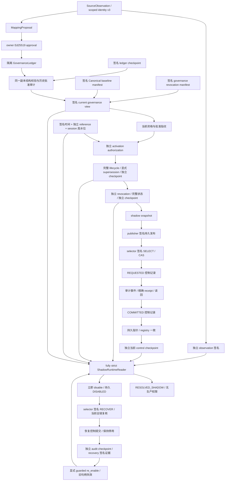

# PHASE 2-P FINAL REPORT

## 1. 仓库身份与精确 SHA

仓库：`https://github.com/YGone-001/Daily-Sports-Lottery.git`；分支 **develop**。
验收起点：`3fc6683081560936dc0ea6e7650155e8cb4123ee`。
保留的 main：`bb8bbe542449ceca3964bae42ad6f132b33b9af2`。
最终提交的 SHA、远程工作流与四个作业结论由提交后的最终交付回复提供，
**本文件不预先宣称尚未发生的最终 CI 成功**。

## 2. 预检与 Git 完整性

执行了 `git fetch origin develop main`、status、三个 rev-parse 和本地作者配置核对。
HEAD 与 origin/develop 精确等于指定起点；工作区干净、无未推送提交，分支 develop。
已读取 AGENTS.md。作者/提交者使用 `YGone <56142733+YGone-001@users.noreply.github.com>`。
前置 [CI 40668271990](https://github.com/YGone-001/Daily-Sports-Lottery/actions/runs/40668271990)
由 GitHub API 证实 **completed/success**，head_sha 与起点一致。

| 前置作业 | GitHub job ID | 实际结果 |
| :--- | ---: | :--- |
| Windows full pytest | 122748252013 | completed/success |
| Windows Canonical lifecycle | 122748252293 | completed/success |
| Ubuntu Canonical lifecycle | 122748252348 | completed/success |
| Ubuntu full pytest | 122748252525 | completed/success |

本次仅前向提交；不 reset/rebase/amend/squash/force-push，不修改或合并 main。

## 3. 完整信任链与组件清单



每个根均来自临时夹具显式配置，**不来自生产根注册表**。
下表 D/B 表示 dataset identity / Canonical baseline；未直接绑定 baseline 的观测和时间，
必须通过下游当前治理、授权和快照共同绑定，不能单独授予消费。

| 组件 / 实际消费调用方 | 输入 / 验证方法 | 签名角色与所给公钥 | D/B 绑定 | 持久状态 / 拒绝行为 |
| :--- | :--- | :--- | :--- | :--- |
| source identity / proposal、Reader | 真实 `SourceObservation`；充分性、规范 scope key、指纹重算 | 无；键本身无权威 | sport/date/provider scope；D 由 attestation、B 由 proposal | 纯函数；不充分键阻断活动绑定 |
| ingestion identity、match identity / scraper | 既有 Canonical 与 incoming；`same_event`、所有者唯一、连通分量一致性 | 无新增签名 | 原身份语义，完全未改 | 原 fail-closed 守卫，不进行修复 |
| observation authority / Reader.read | 签名观测、adapter、scope、完整语义指纹 | observation-public.pem | D 是；B 无直接字段 | 不持久；Reader 暴露 `OBSERVATION_PROVENANCE_INVALID` |
| proposal/owner / ledger.append、eligibility | proposal/approval；Ed25519、用途、主体、内容、观测绑定 | owner_public.pem | D/B 是 | 保留批准原件与 proposal；签名/主体错误拒绝 |
| GovernanceLedger / view builder | 严格历史、状态机、hash/sequence、批准审计 | owner + checkpoint-public.pem | D/B 是 | 仓库外 ledger；错误历史/检查点拒绝，不截断 |
| Canonical/revocation manifests / view builder | 签名清单、精确非空 Canonical、dataset/baseline | checkpoint-public.pem（合成共享角色，见 §4） | Canonical D/B；撤销 D，整体 view 绑定 B | 当前视图派生，无生产源；错 scope 拒绝 |
| authoritative governance / eligibility、strict activation | 同一账本副本、外部 checkpoint、历史 owner 签名、签名 view 事实重算 | governance-public.pem | D/B 是 | 会话批准高水位；缺记录/陈旧/回退拒绝 |
| eligibility / snapshot、strict activation | 当前签名 view + 真实批准 + observation + proposal；现有规则表 | 不新增 signer；owner/view 根 | D/B 是 | 不可变 decision；`NOT_ELIGIBLE`，不创建权限 |
| activation / strict、lifecycle、revocation、Reader | 原 Ed25519 验证器 + 批准指纹/资格/用途/范围 | authorizer_public.pem | D/B 是 | 签名工件保留；精确 activation 拒绝码 |
| trusted time / strict、controller、Reader | 签名 token + 独立 reference；会话、generation、时间边界 | time-public.pem；reference 为独立测试时钟 | D 是；B 不直接绑定 | 仅进程内高水位；过期/回拨/连续性丢失拒绝 |
| supersession / controller、Reader | 完整授权/事件/CURRENT、独立 checkpoint、历史签名 | lifecycle-public.pem + checkpoint-public.pem | D/B/view 指纹 | 进程内单调历史；旧状态/旧快照拒绝 |
| independent revocation / controller、Reader | 完整事件/授权 inventory、lifecycle 绑定、独立检查点 | revocation-public.pem + revocation-checkpoint-public.pem | D/B/lifecycle 是 | 进程内撤销高水位；旧空状态、删历史、已撤销授权拒绝 |
| persistent snapshot / controller | 严格 envelope、原始证据、发布签名、内容和文件指纹 | publisher-public.pem | D/B/策略/授权/lifecycle/revocation/view | 不可变快照；孤立 pending/错误证据拒绝 |
| selection / controller | 独立请求签名、精确绑定、前态 CAS、当前所有安全证据 | selector-public.pem | D/B/全部当前状态 | REQUESTED/COMMITTED 与持久指针；冲突拒绝 |
| audit / controller、recovery | 原始字节、事件、精确 receipt、同一副本验证；外部 checkpoint | 本地事件不是签名；checkpoint-public.pem 签外部锚 | D/store/snapshot；通过 control 绑定 B | JSONL append + fsync；无锚不自称外部认证 |
| control journal/checkpoint / Reader | signed command、journal/audit/pointer/inventory/challenge 逐字段核对 | control_checkpoint-public.pem | D/B 经 signed command/snapshot | 持久 journal/pointer + 会话高水位；失配/回退/uncertainty 拒绝 |
| strict Reader / 合成工具与测试 | 每读重新验证全部原证据；返回成功前再次 control fence | 复用上述根；observation/recovery/view/activation 根仍来自 context | D/B/选中目标 | 无缓存消费授权；失败返回精确 rejection_codes |
| emergency disable / controller | 无需 activation/owner 签名，先停用再尝试 I/O | 不需要 signer | 当前 session | audit/control DISABLED；I/O 失败也不恢复消费 |
| recovery / re_enable | 当前 audit checkpoint、store/tip/count/completion/指针、恢复签名 | recovery-public.pem + checkpoint-public.pem | D/store/selected；当前 B 经全链再验 | 恢复提交持久、Reader 仍停用；错 store/旧证据拒绝 |
| ledger lock / 所有合作账本读写 | 线程 guard + Windows/POSIX 非阻塞 OS 锁、统一 deadline、同锁身份 | 无 | 路径身份而非业务授权 | 锁文件；有界超时、异常正确释放，不创建全局业务锁 |

状态区分：上述隔离控制为 **COMPONENT_IMPLEMENTED / COMPONENT_VERIFIED**；
只有本次完整合成场景连接到真实 Reader 的边界才标记 **INTEGRATION_VERIFIED（隔离）**。
所有生产 authority 仍为 **PRODUCTION_TRUST_SOURCE_MISSING / PRODUCTION_CONTROL_NOT_READY**。
调用方可提供的根、路径、时间和所谓权威事实逐项列于
[生产矩阵 §3](runtime-activation-production-readiness-matrix.md)。

## 4. 现有组件、版本和实际签名角色

| 模块 | 显式版本 | 起点 Git blob | 验收 Git blob |
| :--- | :--- | :--- | :--- |
| `utils/source_identity.py` | 2.0.0, 3.0.0 | `e9e9a859631810798f5d5b33fd112f38726254ea` | `e9e9a859631810798f5d5b33fd112f38726254ea` |
| `utils/ingestion_identity.py` | 以 Git blob 固定 | `cf29696992bc2c656fb9b285949eedd772aff4cb` | `cf29696992bc2c656fb9b285949eedd772aff4cb` |
| `utils/match_identity.py` | 以 Git blob 固定 | `1d61e9e6af4a019262371bbf2af29a6cc9f32af0` | `1d61e9e6af4a019262371bbf2af29a6cc9f32af0` |
| `utils/mapping_governance.py` | 1.0.0, 2.0.0 | `1bbe8ecdee65fba95d0524d2407ffb2544cec4de` | `1bbe8ecdee65fba95d0524d2407ffb2544cec4de` |
| `utils/runtime_mapping_policy.py` | 1.2.0 | `8efd12338630e17ff38da0f8519ac9eec0849664` | `8efd12338630e17ff38da0f8519ac9eec0849664` |
| `utils/runtime_mapping_eligibility.py` | 1.2.0, 1.1.0, 1.0.0 | `0430bc144e8c4795cb8b4a85809a7608df043647` | `0430bc144e8c4795cb8b4a85809a7608df043647` |
| `utils/runtime_activation_authorization.py` | 1.1.0 | `b622cf79dffc1341027fef07e4edbfc7fe2e89c9` | `b622cf79dffc1341027fef07e4edbfc7fe2e89c9` |
| `utils/authoritative_governance.py` | 1.1.0 | `bfdfc0f2e02c9f5a0e020a6eccef7afa879f6192` | `bfdfc0f2e02c9f5a0e020a6eccef7afa879f6192` |
| `utils/observation_authority.py` | 以 Git blob 固定 | `87d1dfdeb150330d89c035033d6cf58b4e7e03bf` | `87d1dfdeb150330d89c035033d6cf58b4e7e03bf` |
| `utils/trusted_artifacts.py` | 1.0.0 | `ac380aa56771a140267fff6028335e7f249ab7b5` | `ac380aa56771a140267fff6028335e7f249ab7b5` |
| `utils/trusted_time_authority.py` | 1.0.0, synthetic-time-v1 | `2e504b215e640112a5912ed17a06eebed0f0d257` | `2e504b215e640112a5912ed17a06eebed0f0d257` |
| `utils/activation_supersession.py` | 1.0.0 | `03e2d2315926665c7b3d7df85f4cab982b9b1090` | `03e2d2315926665c7b3d7df85f4cab982b9b1090` |
| `utils/activation_revocation_authority.py` | 1.0.0 | `e72a07160df87d1845fca628abff8bcfdf5dc4a8` | `e72a07160df87d1845fca628abff8bcfdf5dc4a8` |
| `utils/persistent_shadow_snapshots.py` | 1.0.0 | `1f6012cfe6fbd2684a32a5b70f5917e167280d60` | `1f6012cfe6fbd2684a32a5b70f5917e167280d60` |
| `utils/shadow_snapshot_control.py` | 1.0.0 | `4fcbd5151f4af94ef38907556b1d204684e1de34` | `4fcbd5151f4af94ef38907556b1d204684e1de34` |
| `utils/shadow_snapshot_control_journal.py` | 1.0.0 | `52ea367f198ec14c029c025ae08623c965efc3cc` | `52ea367f198ec14c029c025ae08623c965efc3cc` |
| `utils/shadow_activation_audit_store.py` | 1.3.0 | `b75d0409134e255a841b25b37f5bc0b8cf8e5b1c` | `b75d0409134e255a841b25b37f5bc0b8cf8e5b1c` |
| `utils/shadow_runtime_reader.py` | 1.3.0 | `ffa901c1fe9efe1c1fefd194c6fbc3ebfb844fda` | `edc32587f479a2035965d2291b208c325b7c9e98` |
| `utils/shadow_activation_simulation.py` | 1.3.0 | `5a25a50d2b4a17085c69efa7b24e7c999959662b` | `5a25a50d2b4a17085c69efa7b24e7c999959662b` |
| `utils/recovery_authority.py` | 1.1.0 | `5faeb476e364d600cff1e6ab11caceb517cdd100` | `5faeb476e364d600cff1e6ab11caceb517cdd100` |
| `utils/ledger_lock.py` | local-ledger-lock-v1 | `5b9fc8494bfa5634584d19041c7e5a5a2aaab02f` | `5b9fc8494bfa5634584d19041c7e5a5a2aaab02f` |
| `utils/scraper.py` | 以 Git blob 固定 | `670a2baba598886a9f364297d9d2e50cf834cdc5` | `670a2baba598886a9f364297d9d2e50cf834cdc5` |

13 组不同合成 keypair：owner、activation、governance view、ledger/checkpoint、time、recovery、
lifecycle、revocation、revocation checkpoint、publisher、selector、control checkpoint、observation。
它们全部位于系统临时工作区，不生成生产私钥、不访问实际生产凭据。
`checkpoint-public.pem` 在既有夹具中同时验证 ledger checkpoint、Canonical manifest、治理撤销清单、
lifecycle checkpoint 和 audit checkpoint；这是**明确的合成角色共用**，不是五个独立运维服务。
新 observation key 与 governance key 独立；publisher、selector、control checkpoint 相互独立。
物理部署角色分离、KMS、公钥来源和轮换均未建立。
授权工件 schema 继承 `runtime_activation_design.ACTIVATION_AUTHORIZATION_SCHEMA_VERSION=1.0.0`，
设计契约版本 1.1.0；Reader 持久/公开版本字符串保持 1.3.0，D-01 修正由上表新的 Git blob 明确标识，
没有借修改 schema 或旧身份含义解决并发问题。

## 5. 已验证的来源与治理输入

源数据为 `market_xml` 合成观测；`ScopedSourceIdentityKey` 使用原 v3 算法，充分性来自带 sport/date
的竞彩编号或已验证 provider scope，不把行位置、裸编号或未经验证 provider ID 升级。
观测证明绑定 dataset、观测 ID/指纹、身份版本、种类、值、provider scope、sport/date、adapter 和采集时间。
治理视图确实读取临时 ledger，经精确 checkpoint 绑定，调用 `audit_historical_approvals` 认证历史 owner。
单靠文档或 `approval_audit` 字符串不被当作完整链路证据。
`same_event()`、摄取语义、Canonical ID、生产数据、数学和结算代码均未改。

## 6. owner 批准与当前资格

正常链路实测 `ledger APPROVED transition identity → approved_record → decision.approval_fingerprint
→ activation.approval_fingerprint` 一致。当前批准记录来自经认证历史，不由测试写一个成功布尔值替代。
缺少 owner 身份字段或 approved_records，即使 view 重新签名也不能消费。
批准退出当前状态后原授权不可消费；重新给旧 view 也因已观察到的新账本状态被拒绝。
历史 owner 签名在 A→B 后仍经真实审计器认证，ledger 原字节保持不变。

## 7. activation 授权完整性

独立 activation signer 使用原构造器和验证器；owner 签名不能替代 activation、publisher 或 selector。
修改批准指纹或寿命的对抗工件仍使用真实 activation 签名，并保留历史 A→B inventory，
避免通过删历史制造一个与目标边界无关的先行错误。
错误签名者、批准错配、用途和 scope 继续由既有 verifier 拒绝；没有创建第二套授权规则。

## 8. 可信时间、新鲜度与当前性

| 证据 | 夹具/现有默认窗口 | 当前性 / replay 控制 | 重启边界 |
| :--- | :--- | :--- | :--- |
| observation | 3600 秒 | 签名、dataset、scope、语义指纹；每读再验 | 无独立持久高水位 |
| governance/view/Canonical/checkpoint 输入 | 3600 秒；读 context 可缩短 | view 与事实一致、账本 count/tip/批准状态单调 | 必须重新建立受信当前来源 |
| trusted time | 60 秒，构造最高 300 秒 | 独立 reference、challenge、generation、时间高水位 | 新 challenge；旧 token 不能初始化 |
| activation | 合成最大寿命 86400 秒 | 当前批准、有效区间、撤销；短期 token 不能冻结授权过期 | 不自动重签或启用 |
| lifecycle | 300 秒，构造最高 3600 秒 | 完整历史、唯一 CURRENT、checkpoint challenge、序号 | 新 challenge、独立新检查点 |
| independent revocation | 60 秒，最高 300 秒 | 完整事件和授权集合、lifecycle 绑定、单调历史 | 无生产持久高水位 |
| control command/checkpoint | 60 秒，最高 300 秒 | 精确提交、CAS、audit/journal/pointer、challenge、高水位 | 只读重建，不自动启用 |
| recovery | Reader 默认 3600 秒，构建验证使用 60 秒 audit checkpoint | 当前 store、tip/count、完成事件、selected/effective、generation | 新检查点与当前恢复证据、显式再启用 |

短期授权在同一 Reader 内经过到期边界后，重放仍新鲜的旧 token 也返回
`ACTIVATION_AUTHORIZATION_EXPIRED`。过期 token 返回真实时间拒绝码。
调用方 raw current_time 不替代独立 reference；无生产时间服务或持久时间高水位。

## 9. supersession 与独立撤销当前性

显式 A→B 保留 A 原签名并只把 B 纳入当前可执行快照；没有按时间、ID 排序或最近批准猜测当前授权。
旧 lifecycle checkpoint、旧 A 快照、B 当前撤销、已观察撤销后的空状态回放全部拒绝。
撤销证据必须包含完整 authorization inventory、事件、当前 lifecycle 指纹和独立检查点。
签名合成状态的“当前”只在所给根、会话与新鲜度契约内成立，不是生产全局最新证明。

## 10. 持久发布与认证选择

真实 `PersistentShadowSnapshotStore` 保存原始证据并复核 envelope、内容、签名发布和引用关系。
发布 A 后 registry 无活动选择，Reader 拒绝；真实 selector 签名 SELECT、审计与控制提交、
指针应用和独立提交后 checkpoint 全部完成后才成功读取。
错误或缺失 publication/selection 签名直接打断该链路；对抗场景不预先创建合法选择，
确认伪造发布或选择之后 Reader 仍不能消费。直接 registry 指针修改和错误快照不能成为选择授权。

## 11. audit / control / checkpoint 集成

`REQUESTED → immutable publication（发布时）→ audit event → exact receipt/readback → COMMITTED
→ durable pointer → registry → independent postcommit checkpoint` 是有序多文件协议。
**不是原子多文件事务**。审计存在而控制未提交、控制已提交而指针未应用均可能发生。
控制签名检查点同时绑定日志、审计、指针和发布 inventory；审计链推进后旧证明拒绝。
独立 audit checkpoint 在真实恢复构建器中认证同一审计副本，不能用纯 hash chain 自证外部权威。

## 12. 完整正向 runtime 场景

`IntegratedScenario` 复用既有真实合成 fixture 和原验证模块，新增独立观测签名角色。
完整场景创建作用域 observation、proposal、owner approval、PROPOSED/APPROVED 账本、历史批准审计、
ledger/Canonical/revocation 签名输入和 view、当前资格、独立 activation、time、lifecycle/checkpoint、
独立 revocation/checkpoint、snapshot、认证发布和选择，构造全部严格选项的 Reader。
`test_it01_complete_strict_chain` 验证目标与 proposal/approved_record 一致，结果为
**RESOLVED_SHADOW**、`is_shadow_only=True`、`is_production_authorization=False`。
没有简化 checker、hardcoded success 依赖或生产 storage 写入。
功能工具另执行真实 B 替换、停用、保持停用的恢复、guarded re-enable 和失败后只读重启。

## 13. 单一信任替换矩阵

| 单域替换 | 实际 rejection_codes |
| :--- | :--- |
| `wrong_observation_signer` | `OBSERVATION_PROVENANCE_INVALID` |
| `wrong_dataset` | `TRUSTED_TIME_DATASET_MISMATCH` |
| `wrong_source_scope` | `OBSERVATION_PROVENANCE_INVALID` |
| `wrong_baseline` | `AUTHORITATIVE_GOVERNANCE_VIEW_INVALID`, `BASELINE_STALE` |
| `unauthenticated_owner` | `ACTIVATION_APPROVAL_NOT_AUTHENTICATED` |
| `missing_current_approval` | `ACTIVATION_APPROVAL_NOT_AUTHENTICATED` |
| `wrong_approval_fingerprint` | `ACTIVATION_APPROVAL_FINGERPRINT_MISMATCH` |
| `untrusted_activation_signer` | `REVOCATION_ACTIVATION_SIGNER_MISMATCH` |
| `stale_governance` | `AUTHORITATIVE_GOVERNANCE_VIEW_INVALID` |
| `expired_time` | `TRUSTED_ARTIFACT_STALE` |
| `excessive_lifetime` | `ACTIVATION_LIFETIME_EXCEEDED` |
| `old_lifecycle_checkpoint` | `LIFECYCLE_CHECKPOINT_MISMATCH` |
| `superseded_activation` | `LIFECYCLE_SNAPSHOT_NOT_CURRENT` |
| `revoked_activation` | `ACTIVATION_AUTHORIZATION_REVOKED` |
| `old_nonrevocation` | `REVOCATION_STATE_ROLLBACK` |
| `wrong_publication_signer` | `TRUSTED_ARTIFACT_SIGNER_UNTRUSTED` |
| `wrong_selection_signer` | `TRUSTED_ARTIFACT_SIGNER_UNTRUSTED` |
| `unsigned_publication` | `CONTROL_COMMAND_MISSING` |
| `unsigned_selection` | `CONTROL_COMMAND_MISSING` |
| `old_control_checkpoint` | `CONTROL_CHECKPOINT_MISMATCH` |
| `direct_registry_mutation` | `CONTROL_REGISTRY_BYPASS` |
| `wrong_selected_snapshot` | `SNAPSHOT_NOT_SELECTED` |
| `missing_recovery` | `RE_ENABLE_RECOVERY_EVIDENCE_MISSING` |

消费时替换先取得完整合法选择和成功读取，再替换一个边界；发布/选择替换在对应操作前注入，
不预先建立可绕过缺失链路的合法选择。必要的新 envelope/签名仅维持原契约，保留其他可信输入。
记录的是实现实际产生的拒绝码，不把更早的精确错误改成笼统授权失败。
额外跨角色签名测试涵盖 observation、view、time、lifecycle checkpoint、revocation、control、recovery。

## 14. replay 与状态回退矩阵

| 场景 | 集成证据 / 结果 |
| :--- | :--- |
| 同 Reader 授权到期、旧 time token 重放 | 短授权 5 秒，reference 推进 6 秒；旧 token 不能冻结授权时间 |
| 批准不再当前、旧 view 回放 | 真实 SUPERSEDED 账本与新 view；旧 view 被批准高水位拒绝 |
| A→B、旧 lifecycle 状态 | 真实替换/发布/选择成功后，旧完整证据因单调 inventory/state 约束拒绝 |
| B 独立撤销、早先空状态 | 当前 B 拒绝，旧 empty state 返回 `REVOCATION_STATE_ROLLBACK` |
| 已提交选择后旧 checkpoint | `CONTROL_CHECKPOINT_MISMATCH` |
| 曾成功验证后 audit 推进 | 原 checkpoint 不再匹配当前 audit tip/count |
| 读时 generation/selection 变化 | 最后消费 fence 拒绝，不能返回陈旧成功 |
| 旧结果/cache key 重用 | 旧对象不是权威；即使 cache key 相等，重新 read 仍拒绝过时治理 |
| 丢失 time/governance/lifecycle/revocation/control 连续性 | 五个已建立会话逐项丢失状态均 fail closed |
| verifier 重启无可信连续性 | 公钥重建只读，活动指针为空、Reader 停用；旧 challenge 不足以恢复 |

`is_generation_current()` 只回答代际问题，不承诺时间/治理/全局当前性；本次未把它升级为独立消费权限。

## 15. 紧急停用与 guarded recovery

正常读取 → controller.disable → 持久 DISABLED audit → 当前 inspection/checkpoint → selector RECOVER
→ 当前治理/授权/time/lifecycle/revocation/control 复核 → durable recovery commitment → Reader 仍停用
→ 新 audit checkpoint 与 recovery evidence → 显式 re_enable → 新读取成功。
前序句柄均失效。跨 audit store、错误 effective pointer、audit 推进、过期恢复、superseded activation、
revoked activation、stale selection checkpoint、完成事件已写但指针失败均保持不可消费。
审计服务失败时先行 disable 已生效，不丢失紧急停用。

## 16. 提交故障、崩溃和并发

工具 `commit_faults` 逐项记录实际 persisted delta、acknowledgment、COMMITTED/NOT_COMMITTED/UNCERTAIN、
Reader 状态、内存/持久 pointer、经验证链尖的位置引用和 recovery requirement。
链尖用已验证记录的索引表达，避免随机临时密钥/路径导致报告不确定；原哈希在验证过程中真实比较。

| 注入边界 | 预期持久证据和消费结果 |
| :--- | :--- |
| governance `_write_all` 前故障 | 未确认追加，原 ledger 字节不变；原已认证选择可保留，不虚构新批准 |
| snapshot publication | REQUESTED/拒绝记录可能存在；新 snapshot 未确认发布；停用并清除内存指针 |
| selection intent | 无新业务审计提交，NOT_COMMITTED；停用，保留原始历史 |
| audit append 后确认丢失 | 审计字节已推进但调用未确认，UNCERTAIN；停用并要求恢复 |
| control COMMITTED 前故障 | audit 可见、无控制提交，UNCERTAIN；绝不消费 |
| pointer application | COMMITTED 可见、应用失败，UNCERTAIN；内存指针清空，绝不消费 |
| independent checkpoint creation | 选择已 COMMITTED，但无提交后证明；旧 checkpoint 拒绝读取；不声称选择未提交 |
| recovery completion / pointer | recovery event/control 可能已落盘；应用失败后仍停用，须重新对账 |
| process crash/restart | 真实子进程 `os._exit(73)` 覆盖 intent/audit/commit/pointer/recovery；新 verifier 公钥重建只读 |

故障测试验证原 audit/journal 字节前缀保留。既有套件还覆盖真实 torn tail、fsync、原子文件 pending、
before/after 崩溃边界、不确定结果显式对账；没有自动截尾、回滚审计或重签历史。

并发覆盖：合作进程治理 append/verify、audit append/verify；已有发布/选择锁契约；
线程在读的最后边界协调 selection、revocation、disable 和 audit/checkpoint 推进；
两个签名 recovery 请求只有一个提交，另一个明确 checkpoint 冲突；显式 CAS 错误被持久记录。
锁继续使用 `local-ledger-lock-v1` 和现有控制面锁顺序，不增加业务全局锁。

## 17. Windows / POSIX 验证

本机为 Windows、Python 3.12.10。新 `test_it33_platform_os_lock_and_release` 在当前 OS 使用实际合作子进程，
观察有界 OS contention，并验证释放后重新获取；同一测试不 skip，Ubuntu CI 必须执行 POSIX 实现。
既有 LC 平台专属测试只在相反 OS 跳过，Windows NTFS junction job 继续要求实际运行且不得 skip。
进程崩溃测试不等于硬件断电验证，Windows 目录同步不等于 POSIX directory fsync。
多主机、网络文件系统和不合作目录写入者没有被宣称可线性化。

## 18. 生产入口隔离

检查 app.py 全部 Flask routes、`/api/refresh`、scraper.refresh/_refresh_impl、frontend/src API/hooks/router、
start.bat/start.sh、config.py 环境读取、后台 scraper job、生产 repair 工具、CI。
新增工具还通过 AST 从 app/scraper/config 递归追踪仓库内 import closure，不启动应用或执行抓取。
无自动 Shadow Reader 启动、无激活/选择 API、无 frontend 激活开关、无自动审批或授权签发。
原定时抓取只调用原 scraper；三个生产标志仍关闭，严格原型未默认接入生产。
生产 repair 路径守卫和 Ed25519 授权没有新增旁路；没有 Canonical 迁移、模型/结算改动或新生产写路径。

## 19. 生产信任源与部署缺口

十八项 A–R 的来源、实现位置、根来源、证据、运维责任人、控制、验证/部署状态、阻断和最小功能验收
完整列于 [生产就绪矩阵](runtime-activation-production-readiness-matrix.md)。
未知责任人和来源明确使用 **NOT_ESTABLISHED**，缺乏验证证据使用 **NOT_VERIFIED**，没有猜测。
可验公钥不证明正确生产根；签名合成状态不证明生产全局当前；独立合成 key 不等于独立部署服务。

## 20. IT-01 至 IT-40 验收映射

| IT | 可执行证据 | 验收内容 |
| :--- | :--- | :--- |
| IT-01 | `test_it01_complete_strict_chain` | 完整严格正向解析 |
| IT-02 | `test_integrated_trust_substitution[wrong_observation_signer]` | 错误观测 signer |
| IT-03 | `test_integrated_trust_substitution[wrong_source_scope]` | 错误 scope |
| IT-04 | `test_integrated_trust_substitution[wrong_baseline]` | 错误 Canonical baseline |
| IT-05 | `test_integrated_trust_substitution[unauthenticated_owner]` | 未认证批准记录 |
| IT-06 | `test_integrated_trust_substitution[wrong_approval_fingerprint]` | 错误批准指纹 |
| IT-07 | `test_integrated_trust_substitution[untrusted_activation_signer]` | 错误 activation signer |
| IT-08 | `test_integrated_trust_substitution[stale_governance]` | 陈旧治理视图 |
| IT-09 | `test_integrated_trust_substitution[expired_time]` | 过期可信时间 |
| IT-10 | `test_integrated_trust_substitution[excessive_lifetime]` | 超寿命 |
| IT-11 | `test_integrated_trust_substitution[superseded_activation]` | 已替代授权 |
| IT-12 | `test_integrated_trust_substitution[revoked_activation]` | 当前撤销 |
| IT-13 | `test_integrated_trust_substitution[old_nonrevocation]` | 旧空撤销状态 |
| IT-14 | `test_integrated_trust_substitution[unsigned_publication]` | 未签名发布 |
| IT-15 | `test_integrated_trust_substitution[unsigned_selection]` | 未签名选择 |
| IT-16 | `test_it16_publication_without_selection` | 发布不选择 |
| IT-17 | `test_integrated_trust_substitution[direct_registry_mutation]` | 直接修改 registry |
| IT-18 | `test_integrated_trust_substitution[old_control_checkpoint]` | 陈旧选择检查点 |
| IT-19 | `test_it19_audit_advance_after_success_invalidates_control` | 审计推进 |
| IT-20 | `test_it20_interleaved_mutation_at_final_read_boundary` | 并发选择与最后消费边界 |
| IT-21 | `test_it21_disable_survives_audit_failure / test_newer_emergency_disable_wins_over_inflight_reenable` | 立即停用与新停用优先 |
| IT-22 | `test_it22_guarded_recovery_full_cycle` | 完整 guarded recovery |
| IT-23 | `test_it23_it26_guarded_recovery_boundary[cross_store]` | 跨 store 恢复 |
| IT-24 | `test_it23_it26_guarded_recovery_boundary[stale/audit_advance]` | 旧恢复证据 |
| IT-25 | `test_it23_it26_guarded_recovery_boundary[revoked]` | 撤销阻断再启用 |
| IT-26 | `test_it23_it26_guarded_recovery_boundary[superseded]` | 回滚不能复活 A |
| IT-27 | `test_it27_it28_commit_failure_preserves_history[audit]` | audit uncertainty |
| IT-28 | `test_it27_it28_commit_failure_preserves_history[commit/pointer/recovery]` | control uncertainty |
| IT-29 | `test_it29_public_key_restart_never_auto_enables / test_real_process_crash_reconstructs_read_only` | 真实崩溃与只读重启 |
| IT-30 | `test_it30_lost_continuity_closes_active_session` | 五域连续性丢失 |
| IT-31 | `test_it31_it32_cooperating_process_snapshot[governance]` | 合作进程治理读写 |
| IT-32 | `test_it31_it32_cooperating_process_snapshot[audit]` | 合作进程审计读写 |
| IT-33 | `test_it33_platform_os_lock_and_release` | 真实本机 OS 锁；CI 在两平台执行 |
| IT-34 | `test_it34_historical_signatures_stay_auditable_after_replacement` | 历史认证审计 |
| IT-35 | `test_it35_it36_production_entrypoint_boundaries` | 三个生产标志 |
| IT-36 | `production_boundary_audit / test_it35_it36_production_entrypoint_boundaries` | 入口递归 import/route/frontend 审计 |
| IT-37 | `test_it37_it39_functional_demo_and_seven_store_bytes` | 七库字节 |
| IT-38 | `指定 17 个既有套件 + python -m pytest -q` | 既有安全回归实际结果见 §22 |
| IT-39 | `test_it37_it39_functional_demo_and_seven_store_bytes / CLI` | 功能演示实际执行见 §21 |
| IT-40 | `最终 SHA 的四个 GitHub CI jobs` | 远程证据见最终交付回复，不用本地字符串断言代替 |

IT-38 由指定既有回归和全套实际执行验收，IT-40 由最终 SHA 的真实远程 CI 验收；
没有用一个检查 YAML 字符串的测试冒充远程工作流成功，也没有重复孤立测试来填满编号。

## 21. 可执行功能演示

```powershell
python -m tools.shadow_trust_chain_validation
```

工具使用 TemporaryDirectory 和真实模块，结构化结果包含正常生命周期、单域替换、提交故障、
公钥只读重启、生产 import closure 与路由审计、七库前后 SHA-256。
每个步骤包含 scenario、expected_security_invariant、observed_status、rejection_codes、verified_trust_domains、
audit/control commitment、Reader enabled、snapshot authority、production state。
不打印静态成功表；mandatory require 在 `python -O` 下仍执行；任一不变量失败退出非零。
不输出私钥、随机 workspace 路径或随机工件 ID；报告可确定性比较。

本机最终 CLI：正常模式和 `python -O` 均 **exit 0**；两份 JSON **逐字段完全相等**。
实际执行 **32 个生命周期/替换/停用竞争场景 + 8 个提交故障场景**；13 组合成公钥身份互不相同。
生产静态 import closure 共 **22 个仓库模块**，全部无 shadow 控制入口。
历史基线复现工具实际退出 0，`defect_reproduced=true`；这是故障证据，不是当前实现成功消费。

| 故障 | 审计追加 / 控制追加 | 结果 | Reader enabled | 内存 / 持久选择 |
| :--- | :--- | :--- | :--- | :--- |
| fault_governance | 0 / 0 | NOT_COMMITTED | True | CURRENT / CURRENT |
| fault_publication | 0 / 2 | NOT_COMMITTED | False | NONE / NONE_OR_PREVIOUS |
| fault_intent | 0 / 1 | NOT_COMMITTED | False | NONE / CURRENT |
| fault_audit | 1 / 2 | UNCERTAIN | False | NONE / CURRENT |
| fault_commit | 1 / 2 | UNCERTAIN | False | NONE / CURRENT |
| fault_pointer | 1 / 3 | UNCERTAIN | False | NONE / CURRENT |
| fault_checkpoint | 1 / 2 | COMMITTED | True | CURRENT / CURRENT |
| fault_recovery | 3 / 4 | UNCERTAIN | False | NONE / CURRENT |

追加数从每例原已选择状态计起；recovery 的增量包含新的 DISABLED 审计/控制记录。
所有注入操作均未向调用方确认完成；checkpoint 例中选择本身已提交，失败发生在独立检查点签发。
governance 例失败发生在实际写入之前，原合法选择仍可消费；checkpoint 例 Reader enabled 可为 True，
但旧证明读取明确 REJECTED_SHADOW。其余持久提交故障均停用并清空内存指针。

## 22. 完整本地 pytest 与定向结果

本机 Windows / Python 3.12.10，以下为最终 Reader 实现的真实执行结果。

| 单独执行的 pytest 文件 | 实际结果 |
| :--- | :--- |
| `test_shadow_trust_chain_integration.py` | 78 passed in 224.90s (0:03:44) |
| `test_ledger_read_consistency.py` | 59 passed, 2 skipped in 65.12s (0:01:05) |
| `test_persistent_shadow_snapshot_control.py` | 124 passed in 131.07s (0:02:11) |
| `test_activation_revocation_authority.py` | 97 passed in 5.92s |
| `test_activation_supersession.py` | 82 passed in 4.60s |
| `test_runtime_activation_approval_binding.py` | 65 passed in 3.91s |
| `test_runtime_activation_authorization.py` | 29 passed in 1.20s |
| `test_runtime_activation_trust_hardening.py` | 29 passed in 0.97s |
| `test_trusted_time_authority.py` | 73 passed in 2.74s |
| `test_runtime_activation_recovery_binding.py` | 16 passed in 0.46s |
| `test_shadow_runtime_reader.py` | 20 passed in 0.71s |
| `test_shadow_activation_simulation.py` | 18 passed in 0.37s |
| `test_shadow_activation_audit_store.py` | 12 passed in 0.37s |
| `test_shadow_runtime_authority_corrections.py` | 50 passed in 0.61s |
| `test_runtime_mapping_readiness.py` | 59 passed in 0.79s |
| `test_runtime_activation_security_review.py` | 7 passed in 0.17s |
| `test_canonical_mapping_governance.py` | 45 passed in 1.58s |
| `test_concurrency.py` | 13 passed in 3.72s |

**18 个定向套件合计：876 passed / 2 skipped。**

`python -m pytest -q`：**2137 passed, 2 skipped in 395.78s (0:06:35)**。
两个 skip 为既有相反 OS 专属路径；新集成测试无 skip/xfail，既有安全断言未削弱。

开发中的夹具错误不计作产品缺陷：首次新测试执行为 7 failed / 60 passed，原因包括重用 activation ID、
遗漏旧 inventory、错误地要求 cache key 改变、将“等于 3600 秒窗口”误当作已经过期。
修正夹具后实际通过，未放宽运行期控制或既有安全断言，未新增 security skip/xfail。
中途 D-01 初版修正误用缓存 generation 作为停用计数，一次全套实际为 **7 failed / 2130 passed / 2 skipped**；
普通控制验证也会推进该 generation，导致合法恢复被误拒绝。改用仅由 enable/disable 推进的私有 state epoch
后，正常恢复和并发停用均重跑；中间失败没有计入最终通过证据。

## 23. 七库 SHA-256 字节完整性

| 存储 | 演示前 / 后 SHA-256（完全一致） |
| :--- | :--- |
| `calibrated.json` | `4153a0082dfd7a638cb03c577e16721d47d99c5f1fa487967f83968ec42322ec` |
| `daily_matches.json` | `e78e7da7ad26cca7e8049e4d6761c8162c68bd5ce0fe139687c5dfb30260bcc2` |
| `evaluation_rows.json` | `2b3f68b3b74159b72d6b7cfbbe14b6dfe822914dc237dca0233fda49091611e4` |
| `odds_snapshots.json` | `e04b53c5dec3a0e112e53344f9a56d544f6d7a98c7588fa1d7f46556ecbe6cfe` |
| `prediction_snapshots.json` | `c2c3ee9740150198f61571d0b52ede24a5817198fd75fd7376ef9015b5c8ed25` |
| `settlements.json` | `04e6f6c55e0a4e797699016f2e00788fbb1dc24671082f4fccddbf27f2452364` |
| `team_strength.json` | `ef2737e6fd42fdfbea45eb1aaffd441c7be4c43ea5589f091675887c1d9829f7` |

工具在完整执行前后比较，集成 fixture 在每例前后比较。没有执行生产 repair apply/recover。
data/*.json 未加入变更，六个非 Canonical 文件与 Canonical 文件均字节不变。

## 24. 远程 CI 与最终 SHA

CI 保留 Ubuntu/Windows × Python 3.12 的两个 full-suite 作业和两个 Canonical lifecycle 作业；
两个 full-suite 作业新增执行真实集成演示，错误或七库变化直接失败。
最终 SHA、四个 job ID、实际 pytest totals 和 workflow conclusion 在推送完成后核实，列于最终交付回复。
提交前本地证据不能替代远程证据；**没有预先宣称最终 workflow success**。

## 25. Gates A–AC

| Gate | 项目 | 状态 | 证据与保证范围 |
| :--- | :--- | :--- | :--- |
| A | Exact Baseline Integrity | **PASS** | §1–2：精确起点、干净工作区、正确作者及前置 CI |
| B | Trust-Chain Inventory | **PASS** | §3–4 与生产矩阵：真实输入、调用、根来源和版本 |
| C | Complete Positive Shadow Lifecycle | **PASS** | IT-01 / IT-22 / CLI：完整严格生命周期实际执行 |
| D | Observation and Identity Authenticity | **PASS** | scope/来源签名替换 + 原身份算法 |
| E | Governance and Canonical Authority | **PASS（隔离）** | 认证账本视图、当前所有权、错误 baseline 拒绝 |
| F | Owner Approval Authentication | **PASS** | 真实历史批准审计及未认证记录拒绝 |
| G | Activation Authorization Integrity | **PASS** | 独立签名、批准指纹和跨角色替换 |
| H | Trusted Time and Lifetime | **PASS** | 同 Reader 到期/重放、寿命上限 |
| I | Supersession Currentness | **PASS** | 显式 A→B、旧 lifecycle/snapshot 拒绝 |
| J | Independent Revocation Currentness | **PASS（隔离）** | B 撤销、旧空状态、完整 inventory |
| K | Persistent Snapshot Publication | **PASS** | 真实持久发布；伪造发布后不可消费 |
| L | Authenticated Selection | **PASS** | 真实 selector/CAS；未选择和伪造选择拒绝 |
| M | Audit and Control Commitment | **PASS** | 精确 receipt/readback、8 个提交故障 |
| N | Independent Checkpoints | **PASS（隔离角色）** | ledger/lifecycle/revocation/control/audit 签名与实际状态匹配 |
| O | Strict Reader Consumption | **PASS** | 全严格构造；当前证据每读再验；最后消费 fence |
| P | Emergency Disable | **PASS** | 立即停用、审计失败停用、D-01 新停用优先 |
| Q | Guarded Recovery and Re-Enable | **PASS** | 保持停用的 RECOVER、当前签名恢复、旧句柄失效 |
| R | Replay and State Rollback Protection | **PASS（会话内）** | §14；不声称生产持久或全局当前性 |
| S | Crash/Restart Safety | **PASS（进程崩溃）** | 5 个真实进程退出边界与公钥只读重启 |
| T | Cross-Process Consistency | **PASS（本机合作进程）** | IT-31/32 + 既有 LC 真实进程套件 |
| U | Windows/POSIX Lock Safety | **WINDOWS_PASS / POSIX_PENDING_CI** | Windows 实际 OS 锁；最终双平台 CI 补全 |
| V | Production Entry-Point Isolation | **PASS** | AST 22 模块 import closure、routes、frontend、startup、repair audit |
| W | Production Trust-Source Gap Register | **PASS** | A–R / B-01–14；责任/根未知不猜测 |
| X | Functional Integration Demonstration | **PASS** | 32 场景 + 8 故障；普通/优化 JSON 完全一致 |
| Y | Seven-Store Byte Integrity | **PASS** | §23；七个实际本机 JSON SHA-256 完全一致 |
| Z | Complete Local Regression | **PASS** | 2137 passed / 2 skipped；定向876 passed / 2 skipped |
| AA | Four Remote CI Jobs and Workflow | **PENDING_FINAL_COMMIT_CI** | 最终提交后核实，禁止提前宣称成功 |
| AB | Forward-Only Git Integrity | **PENDING_COMMIT_AND_PUSH** | 提交/推送后核对 HEAD、origin/develop、main 与空工作区 |
| AC | Explicit Production NO-GO | **PASS** | 三标志关闭；PRODUCTION_ACTIVATION_READY=NO / NO-GO |

PASS 只用于可复核实际证据；完整链路门不因单个组件测试通过而通过。
AA 必须由最终 SHA 的四个真实远程作业与 workflow conclusion 决定。

## 26. 已确认集成缺陷与范围

**D-01 / HIGH / 已独立复现并修复**：`ShadowRuntimeReader.re_enable()` 在校验后无状态转换比较，
会覆盖一次较新的紧急停用。直接 Reader 停用交错时，精确基线返回
`reader_enabled=true / reenable_returned_success=true / RESOLVED_SHADOW`。
controller 停用交错也会错误重置 enabled（后续控制检查仍可拒绝消费），两种风险分别验证。

复现命令：

```powershell
python -m tools.shadow_reenablement_baseline
```

复现器导出精确起点 Git archive 到临时目录，在原始代码中运行全严格正向链和真实恢复证据，
在完整再启用校验与状态应用之间插入新的 disable；没有修改导出的运行期源码。
实际两项线程 regression 在修正前 **2 failed**，最小修正后 **2 passed**。

修正只在 Reader 内增加短状态锁与私有 state epoch：开始校验时捕获 epoch，校验仍在锁外执行，
提交 enabled 前在同一锁内比较。disable 先置停用并推进 epoch；过时请求返回
`RE_ENABLE_STATE_CHANGED`，保持新停用和新代际。观察控制/撤销状态的缓存 generation 更新也用同一短锁；
普通证据验证推进缓存 generation 不被误当成新的紧急停用。
没有把 controller、ledger 或文件 I/O 包进状态锁，没有增加跨对象全局锁或新信任 authority。
已有签名、当前批准、时间、supersession、revocation、control checkpoint、recovery 前置全部保留。
正常恢复与故障/并发回归继续实际执行；持久 schema、授权用途、身份算法和生产入口不变。

除经独立复现的 D-01 最小 Reader 并发修正外，变更范围仅 tests、合成工具、文档及 CI；身份语义、生产 API 和模型未改。
已知生产信任源缺口是明确的部署阻断，不通过在验收工具中创建新的 authority 来掩盖。

## 27. B-01 至 B-14 残余风险

见 [生产矩阵 §4](runtime-activation-production-readiness-matrix.md) 和
[阻断项登记](runtime-activation-production-blockers.md)。
B-01/02/03/04/05/06/07/09/10/11/13/14 均有隔离可执行控制，完整链路测试不代表生产关闭。
B-08 在 strict signed view 中验证非空 Canonical/当前唯一 owner，legacy 不能用于生产。
B-12 本报告纠正文档口径，但历史评审的旧状态不能代替当前实现审计。
**没有任何 B 项因本次合成成功而获得 production-closed 状态。**

## 28. 生产基础设施前置顺序

1. 建立可追责生产 owner、数据集/Canonical/治理权威与受控来源。
2. 建立 KMS、分角色身份、公钥发布/轮换/吊销、认证采集和签发服务。
3. 建立可信时间与持久连续性、supersession/revocation 全局当前服务和独立检查点。
4. 建立经过断电验证的持久发布/选择、独立审计、对账恢复、监控与事件响应。
5. 建立不可绕过的生产部署政策，真实环境功能/故障验收后再独立安全复评。

这些是剩余依赖登记，**本次没有开始实施或部署**。

## 29. GO / NO-GO 与停止边界

隔离组件实现、组件验证、跨组件集成、生产信任源存在、运维部署、生产安全批准是六个不同结论。
本次证明合成隔离链路的真实运行和 fail-closed 边界；生产缺少真实信任根来源和运维基础设施。

```text
SHADOW_READER_IMPLEMENTED
PRODUCTION_READER_NOT_ENABLED
PRODUCTION_ACTIVATION = NOT_ENABLED
PRODUCTION_MAPPING_WRITE_AUTHORIZATION = NOT_GRANTED
PRODUCTION_ACTIVATION_READY = NO
DECISION = NO-GO
```

最终任务状态依 Gates 与最终远程证据报告为 PHASE 2-P COMPLETED 或 PHASE 2-P BLOCKED。
停止于验收、文档、回归、前向提交、推送及 CI 核验；不接生产刷新、不部署安全服务、不自动开始后续工作。
