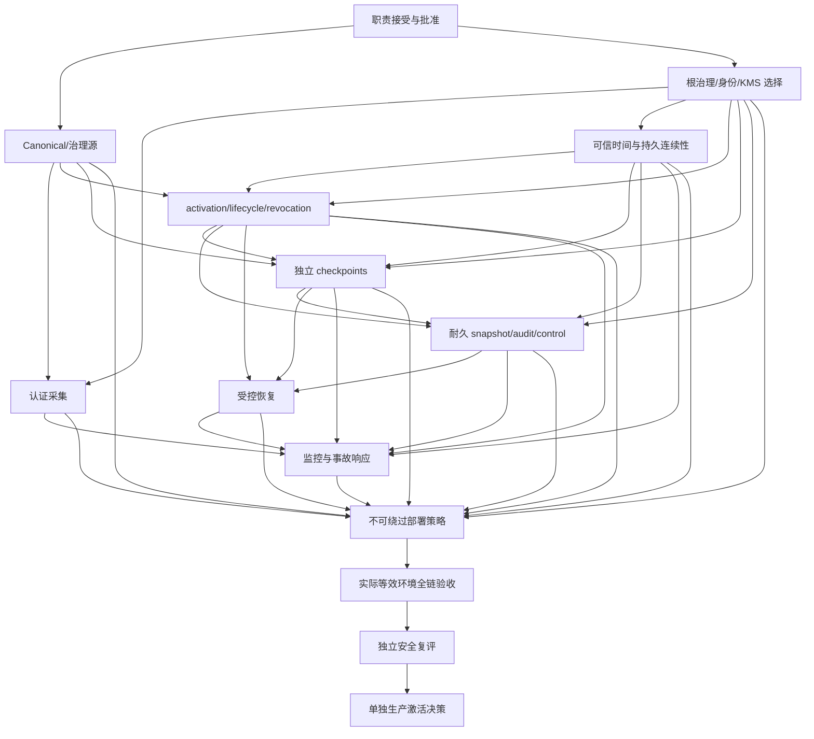

# 生产部署、当前状态、持久连续性和运维安全契约

## 1. 边界和现状

**DESIGNED；实施 BLOCKED；PRODUCTION_ACTIVATION_READY = NO；DECISION = NO-GO。**
本文不实现生产 runtime 工厂、配置系统、API、Reader 集成或基础设施；生产 flags 不变。
JSON 是可离线核对的评审登记，应用不加载。所有生产职责/平台仍 NOT_ESTABLISHED。
以下要求只有经真实部署验证后才能标记 VERIFIED_IN_DEPLOYMENT。

源码核对：`app.py:api_refresh` 和后台刷新直接调用 `scraper.refresh`，未导入 Shadow Reader；
`ShadowRuntimeReader.__init__` 的 require_* 默认为 False；controlled selection 模式检查全部严格依赖
及同一 controller/registry/audit/verifier 对象，但这仍是隔离 opt-in 能力，不能视为生产准入。
`StrictActivationVerifier` 的批准水位、`TrustedTimeVerifier` 的时间水位、lifecycle/revocation/control
会话状态均不能证明跨重启持久连续性；本设计不修改这些实现。

## 2. 当前状态、生命周期和撤销的一致性

activation 签发 E、supersession H、revocation I、current-state publisher 和独立 checkpoint publisher
是不同职责。全部 signer 分离见所有权登记，真实服务身份均待建立。
全局完整状态必须可追溯到所有已提交事件，不能以“caller 提供完整列表”证明完整性。
单一有 fencing 的发布权威只在当前 epoch/leader 租约可证实时发布；分区、两个 CURRENT、同序号不同内容、
缺历史或未知 leader 一律停止发布并阻断消费。选择具体共识/存储机制需要单独授权，
**本设计不声称已提供线性一致性，也不将本机合作锁推导为多主机共识**。

发布必须按 dataset/environment/authority 维持单调 sequence、内容摘要、前序引用、完整 inventory
及持久 authority high-watermark。issuer 在响应前耐久化进度；verifier 在消费前耐久化已观察进度。
独立 checkpoint issuer 直接读取固定权威源并维护独立高水位，不能仅签 writer 声称的摘要。
旧状态重签、新 timestamp、新 nonce 或重建 verifier 都不能绕过当前状态与持久锚比对。
当前状态不能自证全局最新；未选定并验证可提供此证明的平台前维持阻断。

撤销事件绑定 activation ID **和指纹**、dataset/baseline、身份 scope、理由、sequence 和 issuer；
身份特定撤销不能清除其他撤销。业务事件历史不可删，supersession 不得使已撤销授权复活。
应急撤销先停用受影响消费，再由独立 revocation issuer 发布并取得最新 checkpoint；不可达时不得继续消费旧许可。
撤销提交到全部消费者拒绝的预算须经政策批准并实测，不能把 eventual delivery 声称为即时全局可见。
重启/灾难恢复须与外部锚比较 epoch/sequence/完整历史；恢复旧备份不能降低水位或丢失撤销。

## 3. 可信时间、政策和持久连续性

F 的 time issuer 与独立 freshness reference 都需认证，不能使用请求 timestamp 或从同一 token 派生 reference。
分发身份、时间来源、最大 drift、rollback policy、authorization lifetime、freshness、outage、恢复与升级途径
须有具名 policy owner、安全理由和版本批准。任何数值未获批准时为 **POLICY_NOT_APPROVED**。
现有 24 小时授权寿命、60/300 秒 token 窗口、3600 秒 view/recovery 等均属合成/组件默认，
**不自动成为生产政策**。下面 policies 的 value=null 禁止为占位而捏造生产上限。

持久状态至少绑定 environment/dataset、authority/key/root 版本、epoch、最大 attested/reference/effective time、
generation、最近证据与已消费 sequence/tip。启动先比较独立当前锚，取得新 challenge 的最新证明，
成功持久化后仍保持停用，等待受控恢复与显式再启用。时钟回拨、reference 不可达、issuer outage、
持久化失败或 continuity 丢失均拒绝消费、锁定会话并告警；仅设置新 generation 不能修复连续性。
恢复需独立批准可信时间连续性证据与新 epoch，不能把本机时钟或旧备份当作可信起点。

## 4. 快照、审计、崩溃和恢复

现有协议为 REQUESTED → 不可变快照（发布时）→ audit event → 精确回执/读回 → COMMITTED
→ pointer → registry → 独立提交后 checkpoint。`_inspect`、`recover_read_only`、journal 严格解析与
真实进程故障测试提供组件证据；**多个 fsync 和原子 replace 不是跨文件原子事务**。
`BoundedLedgerLock` 只支持本机合作进程；敌对目录替换、网络 FS、多主机和硬件断电尚未验证。

以下 failure_states 精确定义证据、可允许动作、Reader 状态、审计保全、checkpoint 与恢复审批。
COMMITTED 只是可证实提交；仍需当前批准/时间/撤销/选择/根/恢复状态全部满足，才可消费。
UNCERTAIN 即使某些文件物理已写入，也不得静默提升为成功激活。
NOT_COMMITTED 的判断同样需要完整负面证据；单纯没找到日志不能排除确认丢失。
损坏不能自动截尾；保留原字节并通过独立批准的恢复计划重建新可追溯状态。

实际部署平台必须逐提交边界执行进程崩溃与**真实断电/存储丢确认**测试，验证目录同步、rename/link、
文件锁、ACL、磁盘写缓存、journal/audit/pointer 一致性、备份和 restore 的水位防回退。
Windows 与 POSIX 需分别实测；CI 的两平台进程测试不能替代目标硬件/存储断电证据。

恢复流：先禁用并使旧句柄失效 → 保全原状态 → 只读对账 → recovery owner 申请、独立 security 批准
→ selector 签名 RECOVER 与当前全链复核 → 恢复提交保持停用 → 独立新 control/audit checkpoint
→ recovery signer 出具绑定完成事件/store/tip/count/selected/effective/generation 的证据 → 明确批准再启用。
`build_recovery_evidence` 已绑定实际审计副本并要求 NONE 差异；签名恢复证据不能豁免撤销、根吊销或过期。
紧急 disable 先于外部 I/O 生效，审计失败用独立事故渠道留存并保持停用；重启不依赖可用审计自动恢复。

## 5. 不可绕过的未来部署策略

根和模式由批准部署来源固定，记录环境/dataset、根包/策略最低版本、固定 ledger/store/audit 身份和代码摘要。
未来单一受控构造入口强制全部 require_*，并封闭 HTTP、后台、CLI、重启及恢复的 legacy 路径。
请求、任意环境覆盖、caller 公钥、context、registry mutation 均不能改变安全模式或权威来源。
启动必须完成根、治理、时间、撤销、独立 checkpoint 和连续性验证；缺少恢复证据也不能消费。
之前选中过的 snapshot 不会在启动时自动启用。生产 activation flags 在本次继续关闭。
SD-01–15 为逐项降级负向验收，当前只是设计；未对生产 runtime 实施。

## 6. 威胁模型、监控与残余风险

TH-01–20 记录能力、受影响权威、既有保护、缺失部署控制、检测、拒绝行为、未来验收和残余责任人。
全部 OPEN，deployment_mitigated=false；孤立测试通过不能标记场景已在生产缓解。
具有进程任意代码执行/管理员目录写权限的攻击者可能绕过进程内对象与本机合作锁；
部署信任边界、服务身份隔离及独立外部锚必须实测。多独立权威同时失陷仍存在系统性残余风险。

监控必须收集 root/key 版本漂移、非法签发、签名错误、sequence/tip 回退、完整性缺口、clock rollback、
reference/issuer outage、撤销传播延迟、checkpoint stale、CAS 冲突、UNCERTAIN、torn tail、pointer 差异、
恢复越权、disable 持久化失败和部署降级。告警走与被监控服务故障域分离的渠道；
Q 的实际轮值、确认/升级时限、SLO、证据保留与恢复值班均未建立。告警成功不替代 fail closed。
事故流程为检测/先停用 → 证据封存 → 独立根或业务撤销 → 污染范围评估 → 受控恢复 → 独立复评 → 显式再启用。
服务恢复可达不代表完整性恢复，不得自动启用。

## 7. 基础设施依赖图与决策点



原建议顺序不足以自动证明依赖成立：durability 必须先有根、时间、生命周期与独立 checkpoint；
监控应覆盖采集/时间/撤销等每个故障域；部署强制策略依赖全部来源而不只审计。
W01→W03→W05→W06→W07→W08→W09→W10→W11→W12→W13→W14 是结构关键链，
W02 与 W04 也是汇合前置；尚无平台/排期，不能声称这是量化工期的唯一关键路径。
所有 work package 均 BLOCKED；责任 role 只是概念，实际 owner 与平台仍 NOT_ESTABLISHED。

后续需用户单独授权的决策：实际职责与审批接受、部署平台/存储/网络边界、KMS/HSM 供应方、
数据库/一致性机制、独立 checkpoint/时间/审计服务部署、数值政策、保留/RPO/RTO、
生产等效验收环境和独立评审安排，以及最终生产激活权限。本次不做这些选择或部署。

## 8. 结构化部署评审登记

```json
{
  "contract_id": "production-deployment-v1",
  "production_activation_ready": false,
  "decision": "NO-GO",
  "production_flags": {
    "RUNTIME_MAPPING_ACTIVATION": "NOT_ENABLED",
    "PRODUCTION_RUNTIME_READER": "NOT_ENABLED",
    "PRODUCTION_MAPPING_WRITE_AUTHORIZATION": "NOT_GRANTED"
  },
  "current_state_authorities": [
    {
      "authority_id": "A",
      "publisher_role": "governance-view",
      "completeness": "ledger、approved records、proposal states、全部 active bindings 与治理撤销",
      "replay_requirement": "旧序号、同序号不同内容、旧 epoch、缺历史、重新签发旧内容均拒绝；只接受认证当前源",
      "continuity_requirement": "发布与验证高水位在响应/消费前耐久化，并与独立锚比较；重启失败停用",
      "consistency": "单一有 fencing 的发布权威；冲突或分区停止发布和消费；尚未选择可证明此语义的平台",
      "persistent_implementation": "NOT_ESTABLISHED",
      "production_verified": false
    },
    {
      "authority_id": "B",
      "publisher_role": "canonical-publisher",
      "completeness": "整个 dataset 范围 Canonical 与 owner inventory，含完整性见证",
      "replay_requirement": "旧序号、同序号不同内容、旧 epoch、缺历史、重新签发旧内容均拒绝；只接受认证当前源",
      "continuity_requirement": "发布与验证高水位在响应/消费前耐久化，并与独立锚比较；重启失败停用",
      "consistency": "单一有 fencing 的发布权威；冲突或分区停止发布和消费；尚未选择可证明此语义的平台",
      "persistent_implementation": "NOT_ESTABLISHED",
      "production_verified": false
    },
    {
      "authority_id": "F",
      "publisher_role": "time",
      "completeness": "认证时间、reference、generation、epoch",
      "replay_requirement": "旧序号、同序号不同内容、旧 epoch、缺历史、重新签发旧内容均拒绝；只接受认证当前源",
      "continuity_requirement": "发布与验证高水位在响应/消费前耐久化，并与独立锚比较；重启失败停用",
      "consistency": "单一有 fencing 的发布权威；冲突或分区停止发布和消费；尚未选择可证明此语义的平台",
      "persistent_implementation": "NOT_ESTABLISHED",
      "production_verified": false
    },
    {
      "authority_id": "H",
      "publisher_role": "lifecycle-current",
      "completeness": "所有授权、A→B 事件与唯一 CURRENT",
      "replay_requirement": "旧序号、同序号不同内容、旧 epoch、缺历史、重新签发旧内容均拒绝；只接受认证当前源",
      "continuity_requirement": "发布与验证高水位在响应/消费前耐久化，并与独立锚比较；重启失败停用",
      "consistency": "单一有 fencing 的发布权威；冲突或分区停止发布和消费；尚未选择可证明此语义的平台",
      "persistent_implementation": "NOT_ESTABLISHED",
      "production_verified": false
    },
    {
      "authority_id": "I",
      "publisher_role": "revocation-current",
      "completeness": "全部撤销事件、授权清单与被撤销目标",
      "replay_requirement": "旧序号、同序号不同内容、旧 epoch、缺历史、重新签发旧内容均拒绝；只接受认证当前源",
      "continuity_requirement": "发布与验证高水位在响应/消费前耐久化，并与独立锚比较；重启失败停用",
      "consistency": "单一有 fencing 的发布权威；冲突或分区停止发布和消费；尚未选择可证明此语义的平台",
      "persistent_implementation": "NOT_ESTABLISHED",
      "production_verified": false
    },
    {
      "authority_id": "L",
      "publisher_role": "control-checkpoint",
      "completeness": "全部已提交快照、journal、audit、pointer 和禁用状态",
      "replay_requirement": "旧序号、同序号不同内容、旧 epoch、缺历史、重新签发旧内容均拒绝；只接受认证当前源",
      "continuity_requirement": "发布与验证高水位在响应/消费前耐久化，并与独立锚比较；重启失败停用",
      "consistency": "单一有 fencing 的发布权威；冲突或分区停止发布和消费；尚未选择可证明此语义的平台",
      "persistent_implementation": "NOT_ESTABLISHED",
      "production_verified": false
    },
    {
      "authority_id": "M",
      "publisher_role": "audit-checkpoint",
      "completeness": "完整已提交审计前缀与外部锚",
      "replay_requirement": "旧序号、同序号不同内容、旧 epoch、缺历史、重新签发旧内容均拒绝；只接受认证当前源",
      "continuity_requirement": "发布与验证高水位在响应/消费前耐久化，并与独立锚比较；重启失败停用",
      "consistency": "单一有 fencing 的发布权威；冲突或分区停止发布和消费；尚未选择可证明此语义的平台",
      "persistent_implementation": "NOT_ESTABLISHED",
      "production_verified": false
    }
  ],
  "policies": [
    {
      "policy_id": "max_clock_drift",
      "status": "POLICY_NOT_APPROVED",
      "value": null,
      "policy_owner": "NOT_ESTABLISHED",
      "approval_evidence": "NOT_ESTABLISHED",
      "security_rationale": "限制时间伪造与误拒风险，需时间精度/故障预算证据"
    },
    {
      "policy_id": "time_evidence_freshness",
      "status": "POLICY_NOT_APPROVED",
      "value": null,
      "policy_owner": "NOT_ESTABLISHED",
      "approval_evidence": "NOT_ESTABLISHED",
      "security_rationale": "限制 token 冻结时间与 issuer outage 风险"
    },
    {
      "policy_id": "authorization_lifetime",
      "status": "POLICY_NOT_APPROVED",
      "value": null,
      "policy_owner": "NOT_ESTABLISHED",
      "approval_evidence": "NOT_ESTABLISHED",
      "security_rationale": "限制签发 key 失陷窗口，并满足实际撤销传播约束"
    },
    {
      "policy_id": "governance_freshness",
      "status": "POLICY_NOT_APPROVED",
      "value": null,
      "policy_owner": "NOT_ESTABLISHED",
      "approval_evidence": "NOT_ESTABLISHED",
      "security_rationale": "限制撤回批准后的陈旧消费窗口"
    },
    {
      "policy_id": "observation_freshness",
      "status": "POLICY_NOT_APPROVED",
      "value": null,
      "policy_owner": "NOT_ESTABLISHED",
      "approval_evidence": "NOT_ESTABLISHED",
      "security_rationale": "限制采集重放与 provider 内容延迟"
    },
    {
      "policy_id": "lifecycle_freshness",
      "status": "POLICY_NOT_APPROVED",
      "value": null,
      "policy_owner": "NOT_ESTABLISHED",
      "approval_evidence": "NOT_ESTABLISHED",
      "security_rationale": "限制旧 CURRENT 持续可消费窗口"
    },
    {
      "policy_id": "revocation_visibility_budget",
      "status": "POLICY_NOT_APPROVED",
      "value": null,
      "policy_owner": "NOT_ESTABLISHED",
      "approval_evidence": "NOT_ESTABLISHED",
      "security_rationale": "界定撤销从提交到所有消费者拒绝的最坏边界"
    },
    {
      "policy_id": "checkpoint_freshness",
      "status": "POLICY_NOT_APPROVED",
      "value": null,
      "policy_owner": "NOT_ESTABLISHED",
      "approval_evidence": "NOT_ESTABLISHED",
      "security_rationale": "界定截尾/回退可检测时限"
    },
    {
      "policy_id": "recovery_evidence_freshness",
      "status": "POLICY_NOT_APPROVED",
      "value": null,
      "policy_owner": "NOT_ESTABLISHED",
      "approval_evidence": "NOT_ESTABLISHED",
      "security_rationale": "防止旧恢复批准授权新状态"
    },
    {
      "policy_id": "rotation_overlap",
      "status": "POLICY_NOT_APPROVED",
      "value": null,
      "policy_owner": "NOT_ESTABLISHED",
      "approval_evidence": "NOT_ESTABLISHED",
      "security_rationale": "兼顾分发完成与旧失陷 key 的暴露窗口"
    },
    {
      "policy_id": "audit_retention",
      "status": "POLICY_NOT_APPROVED",
      "value": null,
      "policy_owner": "NOT_ESTABLISHED",
      "approval_evidence": "NOT_ESTABLISHED",
      "security_rationale": "满足事故调查/历史批准可追溯需求"
    },
    {
      "policy_id": "monitoring_escalation_budget",
      "status": "POLICY_NOT_APPROVED",
      "value": null,
      "policy_owner": "NOT_ESTABLISHED",
      "approval_evidence": "NOT_ESTABLISHED",
      "security_rationale": "明确发现、投递、值班确认与停用的时限"
    },
    {
      "policy_id": "backup_rpo_rto",
      "status": "POLICY_NOT_APPROVED",
      "value": null,
      "policy_owner": "NOT_ESTABLISHED",
      "approval_evidence": "NOT_ESTABLISHED",
      "security_rationale": "界定允许丢失与恢复时间，但不得丢失撤销或降低高水位"
    }
  ],
  "failure_states": [
    {
      "state": "NOT_COMMITTED",
      "evidence": "完整验证的 journal/audit/指针副本和独立 checkpoint 证明目标没有 COMMITTED；孤立文件或 REQUESTED 不能证明发布",
      "operator_actions": [
        "READ_ONLY_INSPECT",
        "PRESERVE_EVIDENCE",
        "APPROVED_RECOVERY"
      ],
      "reader_consumption": "DENY",
      "audit_preservation": "保留意图、拒绝事件和孤立文件；不自动采纳或删除",
      "checkpoint_requirement": "独立前态及最新否定/差异证明",
      "recovery_approval": "恢复涉及任何写入需 recovery owner 请求与独立 security approver 批准"
    },
    {
      "state": "COMMITTED",
      "evidence": "真实精确审计回执与读回、持久控制 COMMITTED、正确 pointer/registry/inventory，并有提交后独立当前 checkpoint",
      "operator_actions": [
        "READ_ONLY_INSPECT",
        "DISABLE",
        "APPROVED_RECOVERY"
      ],
      "reader_consumption": "CONDITIONAL",
      "audit_preservation": "原始请求、回执、控制提交、指针前后态不可变保留",
      "checkpoint_requirement": "当前提交后联合 checkpoint 与 audit checkpoint",
      "recovery_approval": "重启保持停用，需独立恢复批准、当前证据及显式再启用；COMMITTED 本身不授权"
    },
    {
      "state": "UNCERTAIN",
      "evidence": "I/O 确认丢失、audit 已写而 commit 未证实、commit 已写而 pointer 未证实，或任何无法建立完整提交证据的情形",
      "operator_actions": [
        "DISABLE",
        "PRESERVE_EVIDENCE",
        "READ_ONLY_INSPECT",
        "APPROVED_RECOVERY"
      ],
      "reader_consumption": "DENY",
      "audit_preservation": "不截尾、不重写、不把异常吞成成功；若日志不可写则在独立事故通道留存",
      "checkpoint_requirement": "封存可读前缀并独立确认差异；没有当前证据不能恢复",
      "recovery_approval": "双职责批准签名 RECOVER，独立对账确认；禁止静默提升为 COMMITTED"
    },
    {
      "state": "CORRUPT",
      "evidence": "torn tail、哈希/签名/identity/sequence 错误、互相矛盾的同序号状态或丢失历史",
      "operator_actions": [
        "DISABLE",
        "PRESERVE_EVIDENCE",
        "READ_ONLY_INSPECT",
        "APPROVED_RECOVERY"
      ],
      "reader_consumption": "DENY",
      "audit_preservation": "封存原字节和完整性摘要，不自动修尾或覆盖旧存储",
      "checkpoint_requirement": "独立锚定最后可证明前缀和事故证据；不可自证修复",
      "recovery_approval": "独立安全批准恢复计划与来源；可信副本/新 epoch 必须可追溯"
    },
    {
      "state": "RECOVERY_REQUIRED",
      "evidence": "disabled、重启、连续性丢失、事件/指针差异或恢复缺少最新 checkpoint/签名证据",
      "operator_actions": [
        "DISABLE",
        "READ_ONLY_INSPECT",
        "PRESERVE_EVIDENCE",
        "APPROVED_RECOVERY"
      ],
      "reader_consumption": "DENY",
      "audit_preservation": "记录原因、恢复请求、完成事件及原状态；恢复提交不删除旧状态",
      "checkpoint_requirement": "恢复后新的 control/audit checkpoint、当前治理/时间/lifecycle/revocation 全链证明",
      "recovery_approval": "operational recovery owner + independent security approver，recovery signer 与 selector 执行；保持停用直到单独显式再启用"
    }
  ],
  "strict_downgrades": [
    {
      "id": "SD-01",
      "requirement": "approved_configuration",
      "attack": "将部署配置换成任意本地文件、请求或环境覆盖",
      "expected": "STARTUP_DENIED",
      "entrypoint_coverage": [
        "HTTP",
        "BACKGROUND",
        "CLI",
        "RESTART"
      ],
      "status": "DESIGNED",
      "production_verified": false
    },
    {
      "id": "SD-02",
      "requirement": "environment_identity",
      "attack": "省略/替换 environment 或 dataset",
      "expected": "STARTUP_DENIED",
      "entrypoint_coverage": [
        "HTTP",
        "BACKGROUND",
        "CLI",
        "RESTART"
      ],
      "status": "DESIGNED",
      "production_verified": false
    },
    {
      "id": "SD-03",
      "requirement": "fixed_roots",
      "attack": "请求提供整组自签根、公钥路径或旧根包",
      "expected": "STARTUP_DENIED",
      "entrypoint_coverage": [
        "HTTP",
        "BACKGROUND",
        "CLI",
        "RESTART"
      ],
      "status": "DESIGNED",
      "production_verified": false
    },
    {
      "id": "SD-04",
      "requirement": "startup_validation",
      "attack": "破坏代码/配置摘要、根审批链或 watermark",
      "expected": "STARTUP_DENIED",
      "entrypoint_coverage": [
        "HTTP",
        "BACKGROUND",
        "CLI",
        "RESTART"
      ],
      "status": "DESIGNED",
      "production_verified": false
    },
    {
      "id": "SD-05",
      "requirement": "required_modes",
      "attack": "逐项关闭任何 require_* 模式或更换 verifier 对象",
      "expected": "STARTUP_DENIED",
      "entrypoint_coverage": [
        "HTTP",
        "BACKGROUND",
        "CLI",
        "RESTART"
      ],
      "status": "DESIGNED",
      "production_verified": false
    },
    {
      "id": "SD-06",
      "requirement": "legacy_reader_unreachable",
      "attack": "从每个生产请求/后台/CLI 入口构造 legacy Reader",
      "expected": "CONSUMPTION_DENIED",
      "entrypoint_coverage": [
        "HTTP",
        "BACKGROUND",
        "CLI",
        "RESTART"
      ],
      "status": "DESIGNED",
      "production_verified": false
    },
    {
      "id": "SD-07",
      "requirement": "registry_not_authority",
      "attack": "直接修改 Registry/指针或绕过 selector CAS",
      "expected": "CONSUMPTION_DENIED",
      "entrypoint_coverage": [
        "HTTP",
        "BACKGROUND",
        "CLI",
        "RESTART"
      ],
      "status": "DESIGNED",
      "production_verified": false
    },
    {
      "id": "SD-08",
      "requirement": "governance_required",
      "attack": "缺失/空/陈旧/错误根的治理与完整 owner inventory",
      "expected": "CONSUMPTION_DENIED",
      "entrypoint_coverage": [
        "HTTP",
        "BACKGROUND",
        "CLI",
        "RESTART"
      ],
      "status": "DESIGNED",
      "production_verified": false
    },
    {
      "id": "SD-09",
      "requirement": "time_required",
      "attack": "删除时间证明/reference 或回滚跨重启高水位",
      "expected": "CONSUMPTION_DENIED",
      "entrypoint_coverage": [
        "HTTP",
        "BACKGROUND",
        "CLI",
        "RESTART"
      ],
      "status": "DESIGNED",
      "production_verified": false
    },
    {
      "id": "SD-10",
      "requirement": "revocation_required",
      "attack": "删除撤销服务、重放空状态或重新签旧状态",
      "expected": "CONSUMPTION_DENIED",
      "entrypoint_coverage": [
        "HTTP",
        "BACKGROUND",
        "CLI",
        "RESTART"
      ],
      "status": "DESIGNED",
      "production_verified": false
    },
    {
      "id": "SD-11",
      "requirement": "checkpoints_required",
      "attack": "逐项删除 ledger/lifecycle/revocation/control/audit checkpoint",
      "expected": "CONSUMPTION_DENIED",
      "entrypoint_coverage": [
        "HTTP",
        "BACKGROUND",
        "CLI",
        "RESTART"
      ],
      "status": "DESIGNED",
      "production_verified": false
    },
    {
      "id": "SD-12",
      "requirement": "recovery_evidence_required",
      "attack": "省略恢复证据或复用跨 store/旧 generation 证据",
      "expected": "CONSUMPTION_DENIED",
      "entrypoint_coverage": [
        "HTTP",
        "BACKGROUND",
        "CLI",
        "RESTART"
      ],
      "status": "DESIGNED",
      "production_verified": false
    },
    {
      "id": "SD-13",
      "requirement": "disabled_uncertain_denied",
      "attack": "在 disabled/UNCERTAIN/损坏或连续性不明时消费",
      "expected": "CONSUMPTION_DENIED",
      "entrypoint_coverage": [
        "HTTP",
        "BACKGROUND",
        "CLI",
        "RESTART"
      ],
      "status": "DESIGNED",
      "production_verified": false
    },
    {
      "id": "SD-14",
      "requirement": "restart_no_auto_enable",
      "attack": "重启后仅恢复 previously selected pointer 即尝试消费",
      "expected": "CONSUMPTION_DENIED",
      "entrypoint_coverage": [
        "HTTP",
        "BACKGROUND",
        "CLI",
        "RESTART"
      ],
      "status": "DESIGNED",
      "production_verified": false
    },
    {
      "id": "SD-15",
      "requirement": "flags_unchanged",
      "attack": "尝试通过契约测试、部署 gate 成功或用户请求启用生产标志",
      "expected": "FLAGS_DISABLED",
      "entrypoint_coverage": [
        "HTTP",
        "BACKGROUND",
        "CLI",
        "RESTART"
      ],
      "status": "DESIGNED",
      "production_verified": false
    }
  ],
  "work_packages": [
    {
      "id": "W01",
      "prerequisites": [],
      "authority_ids": [
        "A",
        "B",
        "C",
        "D",
        "E",
        "F",
        "G",
        "H",
        "I",
        "J",
        "K",
        "L",
        "M",
        "N",
        "O",
        "P",
        "Q",
        "R"
      ],
      "implementation_boundary": "实际职责接受与独立批准",
      "responsible_role": "owner-governance-role",
      "actual_owner": "NOT_ESTABLISHED",
      "platform": "NOT_ESTABLISHED",
      "status": "BLOCKED",
      "security_risk": "职责空缺造成自我审批",
      "independent_verification": "逐类核对实际接受记录与分离；不以 repo owner 替代",
      "completion_evidence": "具名接受/批准、版本化实现和独立实际环境验收原始证据；离线契约测试不算完成",
      "stop_condition": "实际 owner、批准或必要平台未建立，依赖未完成或负向行为不符合即停止",
      "grants_production_activation": false
    },
    {
      "id": "W02",
      "prerequisites": [
        "W01"
      ],
      "authority_ids": [
        "A",
        "B",
        "D"
      ],
      "implementation_boundary": "Canonical 和治理来源权威",
      "responsible_role": "canonical-governance-role",
      "actual_owner": "NOT_ESTABLISHED",
      "platform": "NOT_ESTABLISHED",
      "status": "BLOCKED",
      "security_risk": "不完整清单或任意 caller ledger",
      "independent_verification": "对真实数据范围独立重算 inventory 与 baseline，验历史批准/固定来源",
      "completion_evidence": "具名接受/批准、版本化实现和独立实际环境验收原始证据；离线契约测试不算完成",
      "stop_condition": "实际 owner、批准或必要平台未建立，依赖未完成或负向行为不符合即停止",
      "grants_production_activation": false
    },
    {
      "id": "W03",
      "prerequisites": [
        "W01"
      ],
      "authority_ids": [
        "D",
        "O",
        "R"
      ],
      "implementation_boundary": "KMS、身份和根治理（供应商待授权）",
      "responsible_role": "root-custodian-role",
      "actual_owner": "NOT_ESTABLISHED",
      "platform": "NOT_ESTABLISHED",
      "status": "BLOCKED",
      "security_risk": "根替换或角色越权",
      "independent_verification": "带外引导、角色隔离、正常轮换和失陷恢复独立演练",
      "completion_evidence": "具名接受/批准、版本化实现和独立实际环境验收原始证据；离线契约测试不算完成",
      "stop_condition": "实际 owner、批准或必要平台未建立，依赖未完成或负向行为不符合即停止",
      "grants_production_activation": false
    },
    {
      "id": "W04",
      "prerequisites": [
        "W02",
        "W03"
      ],
      "authority_ids": [
        "C"
      ],
      "implementation_boundary": "认证 observation issuer 与原始证据保留",
      "responsible_role": "collection-operator-role",
      "actual_owner": "NOT_ESTABLISHED",
      "platform": "NOT_ESTABLISHED",
      "status": "BLOCKED",
      "security_risk": "正确签名包裹错误来源",
      "independent_verification": "对真实采集身份、scope、provider 内容错误和失陷响应复验",
      "completion_evidence": "具名接受/批准、版本化实现和独立实际环境验收原始证据；离线契约测试不算完成",
      "stop_condition": "实际 owner、批准或必要平台未建立，依赖未完成或负向行为不符合即停止",
      "grants_production_activation": false
    },
    {
      "id": "W05",
      "prerequisites": [
        "W03"
      ],
      "authority_ids": [
        "F",
        "G"
      ],
      "implementation_boundary": "时间与跨重启持久连续性",
      "responsible_role": "time-operator-role",
      "actual_owner": "NOT_ESTABLISHED",
      "platform": "NOT_ESTABLISHED",
      "status": "BLOCKED",
      "security_risk": "时间/高水位回滚",
      "independent_verification": "独立 clock/reference、断服务、状态丢失和备份回滚演练",
      "completion_evidence": "具名接受/批准、版本化实现和独立实际环境验收原始证据；离线契约测试不算完成",
      "stop_condition": "实际 owner、批准或必要平台未建立，依赖未完成或负向行为不符合即停止",
      "grants_production_activation": false
    },
    {
      "id": "W06",
      "prerequisites": [
        "W02",
        "W03",
        "W05"
      ],
      "authority_ids": [
        "E",
        "H",
        "I"
      ],
      "implementation_boundary": "分离 activation、supersession、revocation 和 current-state 权威",
      "responsible_role": "lifecycle-operator-role",
      "actual_owner": "NOT_ESTABLISHED",
      "platform": "NOT_ESTABLISHED",
      "status": "BLOCKED",
      "security_risk": "split-brain 或旧状态重新签名",
      "independent_verification": "真实全局清单、fencing、撤销可见性和跨重启单调性验证",
      "completion_evidence": "具名接受/批准、版本化实现和独立实际环境验收原始证据；离线契约测试不算完成",
      "stop_condition": "实际 owner、批准或必要平台未建立，依赖未完成或负向行为不符合即停止",
      "grants_production_activation": false
    },
    {
      "id": "W07",
      "prerequisites": [
        "W02",
        "W03",
        "W05",
        "W06"
      ],
      "authority_ids": [
        "A",
        "H",
        "I",
        "L",
        "M"
      ],
      "implementation_boundary": "独立 checkpoint issuers",
      "responsible_role": "checkpoint-operator-role",
      "actual_owner": "NOT_ESTABLISHED",
      "platform": "NOT_ESTABLISHED",
      "status": "BLOCKED",
      "security_risk": "writer 与见证共同重写历史",
      "independent_verification": "独立读取与持久水位；checkpoint 签发者不得只签 caller 摘要",
      "completion_evidence": "具名接受/批准、版本化实现和独立实际环境验收原始证据；离线契约测试不算完成",
      "stop_condition": "实际 owner、批准或必要平台未建立，依赖未完成或负向行为不符合即停止",
      "grants_production_activation": false
    },
    {
      "id": "W08",
      "prerequisites": [
        "W03",
        "W05",
        "W06",
        "W07"
      ],
      "authority_ids": [
        "J",
        "K",
        "L",
        "M",
        "P"
      ],
      "implementation_boundary": "耐久 snapshot/audit/control 与平台故障验证",
      "responsible_role": "storage-operator-role",
      "actual_owner": "NOT_ESTABLISHED",
      "platform": "NOT_ESTABLISHED",
      "status": "BLOCKED",
      "security_risk": "多文件非原子和确认丢失",
      "independent_verification": "目标 OS/FS/硬件、真实断电、备份恢复、ACL 和并发 CAS 实测",
      "completion_evidence": "具名接受/批准、版本化实现和独立实际环境验收原始证据；离线契约测试不算完成",
      "stop_condition": "实际 owner、批准或必要平台未建立，依赖未完成或负向行为不符合即停止",
      "grants_production_activation": false
    },
    {
      "id": "W09",
      "prerequisites": [
        "W06",
        "W07",
        "W08"
      ],
      "authority_ids": [
        "N",
        "P"
      ],
      "implementation_boundary": "受控恢复与应急停用",
      "responsible_role": "recovery-operator-role",
      "actual_owner": "NOT_ESTABLISHED",
      "platform": "NOT_ESTABLISHED",
      "status": "BLOCKED",
      "security_risk": "恢复权威滥用",
      "independent_verification": "双职责批准、NONE 差异、保持停用与显式再启用演练",
      "completion_evidence": "具名接受/批准、版本化实现和独立实际环境验收原始证据；离线契约测试不算完成",
      "stop_condition": "实际 owner、批准或必要平台未建立，依赖未完成或负向行为不符合即停止",
      "grants_production_activation": false
    },
    {
      "id": "W10",
      "prerequisites": [
        "W04",
        "W05",
        "W06",
        "W07",
        "W08",
        "W09"
      ],
      "authority_ids": [
        "Q"
      ],
      "implementation_boundary": "监控、轮值、事故处置与独立证据留存",
      "responsible_role": "incident-commander-role",
      "actual_owner": "NOT_ESTABLISHED",
      "platform": "NOT_ESTABLISHED",
      "status": "BLOCKED",
      "security_risk": "应急服务不可达或告警丢失",
      "independent_verification": "断开每个 issuer/checkpoint/audit 并验证告警与拒绝，停用无审计依赖",
      "completion_evidence": "具名接受/批准、版本化实现和独立实际环境验收原始证据；离线契约测试不算完成",
      "stop_condition": "实际 owner、批准或必要平台未建立，依赖未完成或负向行为不符合即停止",
      "grants_production_activation": false
    },
    {
      "id": "W11",
      "prerequisites": [
        "W02",
        "W03",
        "W04",
        "W05",
        "W06",
        "W07",
        "W08",
        "W09",
        "W10"
      ],
      "authority_ids": [
        "R"
      ],
      "implementation_boundary": "不可绕过部署准入与严格构造边界",
      "responsible_role": "deployment-operator-role",
      "actual_owner": "NOT_ESTABLISHED",
      "platform": "NOT_ESTABLISHED",
      "status": "BLOCKED",
      "security_risk": "legacy、根、模式或入口降级",
      "independent_verification": "SD-01 至 SD-15 全入口负向验收，启动默认停用",
      "completion_evidence": "具名接受/批准、版本化实现和独立实际环境验收原始证据；离线契约测试不算完成",
      "stop_condition": "实际 owner、批准或必要平台未建立，依赖未完成或负向行为不符合即停止",
      "grants_production_activation": false
    },
    {
      "id": "W12",
      "prerequisites": [
        "W11"
      ],
      "authority_ids": [
        "A",
        "B",
        "C",
        "D",
        "E",
        "F",
        "G",
        "H",
        "I",
        "J",
        "K",
        "L",
        "M",
        "N",
        "O",
        "P",
        "Q",
        "R"
      ],
      "implementation_boundary": "实际等效环境完整链路和故障验收",
      "responsible_role": "acceptance-reviewer-role",
      "actual_owner": "NOT_ESTABLISHED",
      "platform": "NOT_ESTABLISHED",
      "status": "BLOCKED",
      "security_risk": "以合成通过冒充生产证明",
      "independent_verification": "独立复跑 PA-A–R 与威胁用例，原始日志绑定部署版本",
      "completion_evidence": "具名接受/批准、版本化实现和独立实际环境验收原始证据；离线契约测试不算完成",
      "stop_condition": "实际 owner、批准或必要平台未建立，依赖未完成或负向行为不符合即停止",
      "grants_production_activation": false
    },
    {
      "id": "W13",
      "prerequisites": [
        "W12"
      ],
      "authority_ids": [
        "O",
        "Q",
        "R"
      ],
      "implementation_boundary": "独立安全复评",
      "responsible_role": "independent-security-reviewer-role",
      "actual_owner": "NOT_ESTABLISHED",
      "platform": "NOT_ESTABLISHED",
      "status": "BLOCKED",
      "security_risk": "自证关闭阻断项",
      "independent_verification": "独立证据清单、未解决风险与拒绝条件逐项签署",
      "completion_evidence": "具名接受/批准、版本化实现和独立实际环境验收原始证据；离线契约测试不算完成",
      "stop_condition": "实际 owner、批准或必要平台未建立，依赖未完成或负向行为不符合即停止",
      "grants_production_activation": false
    },
    {
      "id": "W14",
      "prerequisites": [
        "W13"
      ],
      "authority_ids": [
        "R"
      ],
      "implementation_boundary": "单独生产激活决策",
      "responsible_role": "production-decision-role",
      "actual_owner": "NOT_ESTABLISHED",
      "platform": "NOT_ESTABLISHED",
      "status": "BLOCKED",
      "security_risk": "自动 gate 通过被当作许可",
      "independent_verification": "用户单独授权明确环境/范围/版本；本工作包仍不执行激活",
      "completion_evidence": "具名接受/批准、版本化实现和独立实际环境验收原始证据；离线契约测试不算完成",
      "stop_condition": "实际 owner、批准或必要平台未建立，依赖未完成或负向行为不符合即停止",
      "grants_production_activation": false
    }
  ],
  "threats": [
    {
      "id": "TH-01",
      "scenario": "compromised_owner_key",
      "attacker_capabilities": "可伪造 owner 批准",
      "authority_id": "D",
      "existing_protection": "历史批准验签和当前 view 指纹绑定",
      "missing_deployment_control": "独立 owner registry/key 吊销及污染窗口处置",
      "detection": "非法批准与登记/吊销差异",
      "fail_closed": "DENY_CONSUMPTION_AND_PRESERVE_EVIDENCE",
      "required_acceptance_test": "失陷 key、历史有效批准再消费必须拒绝",
      "residual_risk_owner": "NOT_ESTABLISHED",
      "status": "OPEN",
      "deployment_mitigated": false
    },
    {
      "id": "TH-02",
      "scenario": "compromised_activation_signer",
      "attacker_capabilities": "可签合法 activation",
      "authority_id": "E",
      "existing_protection": "当前批准绑定、用途/期限、独立 lifecycle/revocation",
      "missing_deployment_control": "KMS 最小权限、根吊销、事件响应",
      "detection": "无对应批准或异常签发速率",
      "fail_closed": "DENY_CONSUMPTION_AND_PRESERVE_EVIDENCE",
      "required_acceptance_test": "合法 signer 签超范围/失陷 key，拒绝消费",
      "residual_risk_owner": "NOT_ESTABLISHED",
      "status": "OPEN",
      "deployment_mitigated": false
    },
    {
      "id": "TH-03",
      "scenario": "compromised_revocation_signer",
      "attacker_capabilities": "可伪造、删减或隐瞒撤销",
      "authority_id": "I",
      "existing_protection": "完整清单、保留事件和独立 checkpoint",
      "missing_deployment_control": "独立 current publisher/fencing、高水位、应急根撤销",
      "detection": "签发记录/全局序号/checkpoint 不一致",
      "fail_closed": "DENY_CONSUMPTION_AND_PRESERVE_EVIDENCE",
      "required_acceptance_test": "真实撤销后旧空状态新签名仍拒绝",
      "residual_risk_owner": "NOT_ESTABLISHED",
      "status": "OPEN",
      "deployment_mitigated": false
    },
    {
      "id": "TH-04",
      "scenario": "compromised_checkpoint_signer",
      "attacker_capabilities": "可签任意 checkpoint",
      "authority_id": "L",
      "existing_protection": "精确多存储绑定、各业务签名",
      "missing_deployment_control": "独立见证、root 撤销、部署级身份分离",
      "detection": "多方观察/存储事实与 checkpoint 冲突",
      "fail_closed": "DENY_CONSUMPTION_AND_PRESERVE_EVIDENCE",
      "required_acceptance_test": "伪 checkpoint 有效签名也不能覆盖当前已知状态",
      "residual_risk_owner": "NOT_ESTABLISHED",
      "status": "OPEN",
      "deployment_mitigated": false
    },
    {
      "id": "TH-05",
      "scenario": "malicious_operator",
      "attacker_capabilities": "控制请求参数或选择指针",
      "authority_id": "K",
      "existing_protection": "签名命令、CAS、registry bypass 拒绝",
      "missing_deployment_control": "操作者 MFA/权限与双职责审批",
      "detection": "越权命令和指针不一致告警",
      "fail_closed": "DENY_CONSUMPTION_AND_PRESERVE_EVIDENCE",
      "required_acceptance_test": "直接写 registry、伪操作者/越权选择均拒绝",
      "residual_risk_owner": "NOT_ESTABLISHED",
      "status": "OPEN",
      "deployment_mitigated": false
    },
    {
      "id": "TH-06",
      "scenario": "forged_source_observation",
      "attacker_capabilities": "伪造 observation 与 provider 字符串",
      "authority_id": "C",
      "existing_protection": "语义指纹、scope、adapter 和签名核验",
      "missing_deployment_control": "固定采集身份与原始证据保留",
      "detection": "原始证据缺失/adapter scope 异常",
      "fail_closed": "DENY_CONSUMPTION_AND_PRESERVE_EVIDENCE",
      "required_acceptance_test": "错误采集身份、改 scope、错误内容处理分别验收",
      "residual_risk_owner": "NOT_ESTABLISHED",
      "status": "OPEN",
      "deployment_mitigated": false
    },
    {
      "id": "TH-07",
      "scenario": "stale_signed_view",
      "attacker_capabilities": "重放有效签名旧批准视图",
      "authority_id": "A",
      "existing_protection": "批准状态会话高水位与 freshness",
      "missing_deployment_control": "固定全局当前源、持久水位",
      "detection": "发布序号/tip 与最新外部锚差异",
      "fail_closed": "DENY_CONSUMPTION_AND_PRESERVE_EVIDENCE",
      "required_acceptance_test": "新 verifier 重启后旧 view 仍拒绝",
      "residual_risk_owner": "NOT_ESTABLISHED",
      "status": "OPEN",
      "deployment_mitigated": false
    },
    {
      "id": "TH-08",
      "scenario": "complete_history_rewrite",
      "attacker_capabilities": "重写全账本及内部 hash",
      "authority_id": "A",
      "existing_protection": "外部 ledger/audit checkpoint 与历史 owner 验签",
      "missing_deployment_control": "独立不可变保留与根治理",
      "detection": "独立锚比对失败",
      "fail_closed": "DENY_CONSUMPTION_AND_PRESERVE_EVIDENCE",
      "required_acceptance_test": "完整重写仍内部自洽但外部锚拒绝",
      "residual_risk_owner": "NOT_ESTABLISHED",
      "status": "OPEN",
      "deployment_mitigated": false
    },
    {
      "id": "TH-09",
      "scenario": "valid_tail_truncation",
      "attacker_capabilities": "保留有效链前缀并删尾",
      "authority_id": "M",
      "existing_protection": "精确 checkpoint tip/count",
      "missing_deployment_control": "独立 publisher 与持久最新状态",
      "detection": "外部 count/tip 比对",
      "fail_closed": "DENY_CONSUMPTION_AND_PRESERVE_EVIDENCE",
      "required_acceptance_test": "有效前缀删尾不可自动采纳",
      "residual_risk_owner": "NOT_ESTABLISHED",
      "status": "OPEN",
      "deployment_mitigated": false
    },
    {
      "id": "TH-10",
      "scenario": "root_configuration_replacement",
      "attacker_capabilities": "替换配置、全部根与工件",
      "authority_id": "O",
      "existing_protection": "部分构造时根指纹固定",
      "missing_deployment_control": "独立部署准入、配置摘要/最低版本",
      "detection": "启动配置审批链失配",
      "fail_closed": "DENY_CONSUMPTION_AND_PRESERVE_EVIDENCE",
      "required_acceptance_test": "整组根替换在启动时拒绝",
      "residual_risk_owner": "NOT_ESTABLISHED",
      "status": "OPEN",
      "deployment_mitigated": false
    },
    {
      "id": "TH-11",
      "scenario": "stale_state_resigning",
      "attacker_capabilities": "用合法 key 给旧状态新签名",
      "authority_id": "I",
      "existing_protection": "同会话清单/序号不回退",
      "missing_deployment_control": "issuer 高水位耐久化与独立全局见证",
      "detection": "最新锚与签发日志不匹配",
      "fail_closed": "DENY_CONSUMPTION_AND_PRESERVE_EVIDENCE",
      "required_acceptance_test": "新 challenge/新时间签旧状态也拒绝",
      "residual_risk_owner": "NOT_ESTABLISHED",
      "status": "OPEN",
      "deployment_mitigated": false
    },
    {
      "id": "TH-12",
      "scenario": "clock_rollback",
      "attacker_capabilities": "回滚 token/reference 或冻结时间",
      "authority_id": "F",
      "existing_protection": "独立 reference、challenge 与会话水位",
      "missing_deployment_control": "认证分发、持久时间状态、已批准 drift 政策",
      "detection": "时间/reference 水位差异",
      "fail_closed": "DENY_CONSUMPTION_AND_PRESERVE_EVIDENCE",
      "required_acceptance_test": "同进程和重启的时间回滚均停用",
      "residual_risk_owner": "NOT_ESTABLISHED",
      "status": "OPEN",
      "deployment_mitigated": false
    },
    {
      "id": "TH-13",
      "scenario": "watermark_rollback",
      "attacker_capabilities": "恢复旧备份或删除水位",
      "authority_id": "G",
      "existing_protection": "会话连续性丢失 fail closed",
      "missing_deployment_control": "独立防回滚存储/epoch 与检查点",
      "detection": "本地 epoch/sequence 小于外部锚",
      "fail_closed": "DENY_CONSUMPTION_AND_PRESERVE_EVIDENCE",
      "required_acceptance_test": "备份回滚重启不能重放旧许可",
      "residual_risk_owner": "NOT_ESTABLISHED",
      "status": "OPEN",
      "deployment_mitigated": false
    },
    {
      "id": "TH-14",
      "scenario": "audit_adapter_substitution",
      "attacker_capabilities": "替换 audit 对象/回执",
      "authority_id": "M",
      "existing_protection": "精确 receipt、实际读回与 store identity",
      "missing_deployment_control": "固定服务身份、ACL 和部署依赖",
      "detection": "身份/读回/tip 不一致",
      "fail_closed": "DENY_CONSUMPTION_AND_PRESERVE_EVIDENCE",
      "required_acceptance_test": "相同 API 假适配器与跨 store 回执拒绝",
      "residual_risk_owner": "NOT_ESTABLISHED",
      "status": "OPEN",
      "deployment_mitigated": false
    },
    {
      "id": "TH-15",
      "scenario": "filesystem_path_replacement",
      "attacker_capabilities": "替换目录、junction、symlink 或硬链接",
      "authority_id": "P",
      "existing_protection": "路径守卫与合作锁",
      "missing_deployment_control": "实际平台权限、隔离目录与敌对替换验证",
      "detection": "路径/文件身份变化",
      "fail_closed": "DENY_CONSUMPTION_AND_PRESERVE_EVIDENCE",
      "required_acceptance_test": "真实目标 FS 目录替换和别名用例；未覆盖攻击维持阻断",
      "residual_risk_owner": "NOT_ESTABLISHED",
      "status": "OPEN",
      "deployment_mitigated": false
    },
    {
      "id": "TH-16",
      "scenario": "concurrent_conflicting_selection",
      "attacker_capabilities": "相同前态并发选择",
      "authority_id": "K",
      "existing_protection": "CAS 与 controller/leaf 合作锁",
      "missing_deployment_control": "单 writer fencing 与目标存储语义",
      "detection": "CAS 冲突、双提交或 generation 异常",
      "fail_closed": "DENY_CONSUMPTION_AND_PRESERVE_EVIDENCE",
      "required_acceptance_test": "并发冲突只允许可证明的唯一提交，失败保全证据",
      "residual_risk_owner": "NOT_ESTABLISHED",
      "status": "OPEN",
      "deployment_mitigated": false
    },
    {
      "id": "TH-17",
      "scenario": "split_brain_publication",
      "attacker_capabilities": "两个发布者并行签 CURRENT",
      "authority_id": "H",
      "existing_protection": "同会话矛盾状态与 inventory 拒绝",
      "missing_deployment_control": "带 fencing 的单权威、分区拒绝",
      "detection": "相同 epoch/sequence 不同根或 CURRENT",
      "fail_closed": "DENY_CONSUMPTION_AND_PRESERVE_EVIDENCE",
      "required_acceptance_test": "真实网络分区/恢复无双 CURRENT，不承诺未经证明的线性一致性",
      "residual_risk_owner": "NOT_ESTABLISHED",
      "status": "OPEN",
      "deployment_mitigated": false
    },
    {
      "id": "TH-18",
      "scenario": "recovery_authority_misuse",
      "attacker_capabilities": "签伪恢复/回退证据",
      "authority_id": "N",
      "existing_protection": "store/tip/count/generation/选择绑定与 NONE 差异",
      "missing_deployment_control": "独立恢复批准和执行分离",
      "detection": "无批准的恢复命令、旧证据",
      "fail_closed": "DENY_CONSUMPTION_AND_PRESERVE_EVIDENCE",
      "required_acceptance_test": "有效 recovery key 也不能单独批准或清除撤销",
      "residual_risk_owner": "NOT_ESTABLISHED",
      "status": "OPEN",
      "deployment_mitigated": false
    },
    {
      "id": "TH-19",
      "scenario": "emergency_disable_outage",
      "attacker_capabilities": "停用时 audit 或远端服务不可达",
      "authority_id": "Q",
      "existing_protection": "先停用、持久 DISABLED、旧句柄失效",
      "missing_deployment_control": "独立本地禁用持久化与事故通道",
      "detection": "停用确认缺失与日志不可达",
      "fail_closed": "DENY_CONSUMPTION_AND_PRESERVE_EVIDENCE",
      "required_acceptance_test": "所有依赖不可达仍先拒绝；重启不自动启用",
      "residual_risk_owner": "NOT_ESTABLISHED",
      "status": "OPEN",
      "deployment_mitigated": false
    },
    {
      "id": "TH-20",
      "scenario": "unauthorized_strict_downgrade",
      "attacker_capabilities": "修改 require_*、legacy 入口或部署 flags",
      "authority_id": "R",
      "existing_protection": "controlled selection 构造强一致严格对象",
      "missing_deployment_control": "非请求可控的部署策略与封闭入口",
      "detection": "启动准入拒绝、部署漂移告警",
      "fail_closed": "DENY_CONSUMPTION_AND_PRESERVE_EVIDENCE",
      "required_acceptance_test": "SD-01–15 每入口执行并确认 flags 仍关闭",
      "residual_risk_owner": "NOT_ESTABLISHED",
      "status": "OPEN",
      "deployment_mitigated": false
    }
  ],
  "recovery": {
    "operational_approval": "NOT_ESTABLISHED",
    "required_approval_roles": [
      "operational-recovery-owner",
      "independent-security-approver"
    ],
    "executor_roles": [
      "selector",
      "recovery"
    ],
    "self_approval_allowed": false,
    "auto_reenable_allowed": false
  },
  "linearizability_claimed": false,
  "uncertain_auto_promote": false,
  "production_progress": {
    "DESIGNED": "YES",
    "OWNER_ASSIGNED": "NO",
    "APPROVED": "NO",
    "IMPLEMENTED": "NO",
    "VERIFIED_IN_TEST": "NO",
    "VERIFIED_IN_DEPLOYMENT": "NO",
    "PRODUCTION_AUTHORIZED": "NO"
  }
}
```

## 9. 交付状态

本文件满足设计记录后仍只为 DESIGNED。OWNER_ASSIGNED、APPROVED、IMPLEMENTED、
VERIFIED_IN_TEST、VERIFIED_IN_DEPLOYMENT、PRODUCTION_AUTHORIZED 各自需要真实独立证据；
离线检查仅验证本契约内部一致性，不设置任何生产状态。
**PRODUCTION_ACTIVATION_READY = NO；DECISION = NO-GO。**
